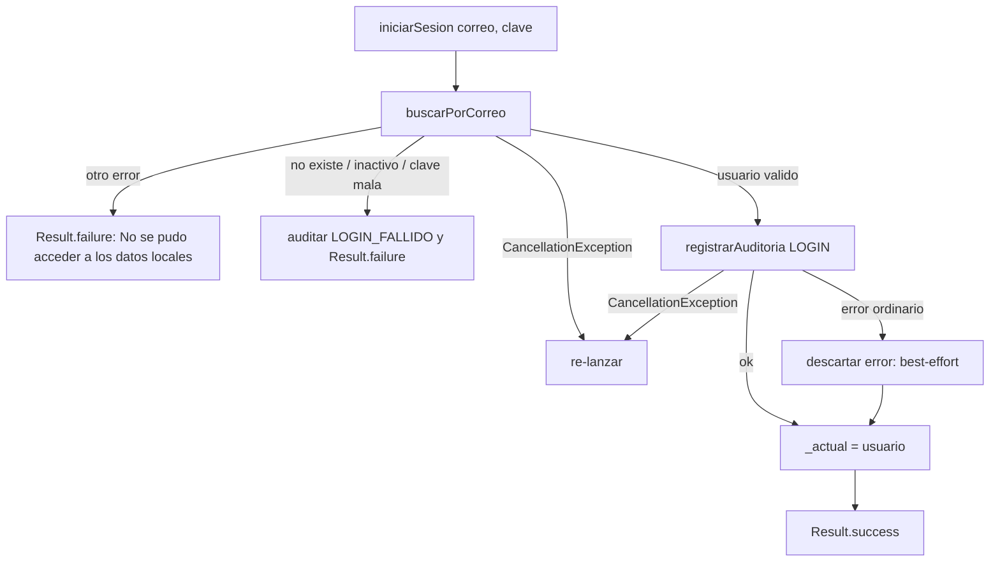

# Lemac DataLab + Gestión Documental

Aplicacion Android **unificada** desarrollada en Kotlin y Jetpack Compose. Integra en un solo APK dos trabajos academicos que antes eran proyectos separados: un modulo de bienestar y un modulo de gestion documental de RR.HH. Al abrir la app aparece un **portal** desde el que se elige el modulo con el que se quiere trabajar.

El **modulo de bienestar** es Lemac DataLab: un autorregistro que permite anotar, en pocos pasos, como se siente la persona y que estrategias utiliza en cuatro ambitos de bienestar: neurodesarrollo, habilidades DBT, estado de animo y adicciones.

El **modulo de gestion documental** replica el flujo documental de RR.HH. de una institucion de salud: login con siete roles, documentos con versiones, bandeja de aprobacion, auditoria, gestion de usuarios y reportes, todo con datos ficticios.

El proyecto se presenta como un **MVP academico**. Su objetivo es demostrar un flujo completo de aplicacion movil: interfaz Compose, navegacion, estado, persistencia local, recordatorios, una capa de sincronizacion simulada y exportacion local de los datos a CSV.

> Nota historica: en una etapa previa se decidio mantener ambos dominios como proyectos separados (decision `d7c47dc1`). Esa decision quedo **reemplazada** por la instruccion del supervisor de entregar los dos trabajos como una sola app funcional (decision `06db8960`, "Opcion A"). El detalle completo de la integracion esta en [docs/INTEGRACION.md](docs/INTEGRACION.md).


## Traspaso y replicación para principiantes

Esta sección es un "manual de relevo" para que una persona que **no sabe nada** de Android, Kotlin ni de este proyecto pueda entenderlo, ejecutarlo y continuar el trabajo. Está escrita en español claro y con ejemplos concretos.

### Identificadores de trazabilidad (Lemoria / SDD)

Incluye estos identificadores cuando hables del trabajo documentado o de su seguimiento:

| Identificador | Valor | Uso |
|---|---|---|
| `project-id` | `136316a2-36dd-43b5-aa80-05b9e97d3f22` | Proyecto en Lemoria |
| `prd-id` | `c46eb0c9-d681-40b3-99fb-c2336db498d6` | PRD/alcance de este manual de traspaso |
| `conv-id` | `46c48af9-f33b-4546-a4b0-96393bcf6eeb` | Conversación de trabajo |
| `task-id` (auditoría) | `f4b1d51e-13e2-4878-9164-38b2bda8b9f6` | Auditoría documental |
| `task-id` (GUIA_ESTUDIO) | `4ad8e55f-e7bd-46bc-925e-f75f64593621` | Actualización de guía de estudio |
| `task-id` (NOTAS_TECNICAS) | `815d9c90-62b7-4737-82e7-c2e85026aafc` | Actualización de notas técnicas |
| `task-id` (README) | `c20ea3bb-cc8c-4ab2-8734-64bf7fefa54f` | Actualización de este README |
| `task-id` (mock API README) | `bf4cb5cc-f359-4aa5-bcda-86c2e5ea772d` | Actualización de README de API simulada |

> Nota: las notas técnicas del cierre de hardening (2026-11-19) registran además otro PRD/conversación/task (`045a2de8-e11f-4286-930f-ed582728e411`, `9b337131-5f44-49d8-b4f1-8edad505507b`, `f8dfcced-828f-4140-8a27-3e350e295a43`). Ambos conjuntos son válidos: uno corresponde al hardening previo y otro a este manual de traspaso.

**Placeholders de los comandos SDD** (los textos entre `<...>` se sustituyen por valores reales): `<project-id>` = identificador del proyecto en Lemoria (ej. `136316a2-...`), `<prd-id>` = identificador del PRD/flujo (ej. `c46eb0c9-...`), `<task-id>` = identificador de una tarea, `<sha>` = hash corto del commit.

### Índice de guías (enlaces)

| Documento | Para qué sirve | Ruta |
|---|---|---|
| Guía de estudio (principiantes + técnica) | Glosario, mapa de carpetas, arquitectura por capas, recorrido pantalla a pantalla y detalle de componentes | [docs/GUIA_ESTUDIO.md](docs/GUIA_ESTUDIO.md) |
| Notas técnicas y SDD | Flujo SDD con Lemoria (pasos y comandos), ADRs, trazabilidad de commits y estado del hardening | [docs/NOTAS_TECNICAS.md](docs/NOTAS_TECNICAS.md) |
| API simulada (mock) | Cómo arrancar el servidor local en Linux/Windows, URLs por contexto y solución de problemas | [tools/mock_api/README.md](tools/mock_api/README.md) |
| Guion de disertación | Apoyo para exposición; complementa (no reemplaza) las guías de traspaso | [docs/DISERTACION.md](docs/DISERTACION.md) |
| Integración de los dos módulos | Cómo se unificaron bienestar y gestión documental en un solo APK | [docs/INTEGRACION.md](docs/INTEGRACION.md) |
| Integración API REST (IT3) | Detalle técnico de `GET /documentos` con Retrofit | [docs/INTEGRACION_API_IT3.md](docs/INTEGRACION_API_IT3.md) |

### Dónde está el PDF

- **En el repositorio:** [docs/INFORME_ARQUITECTURA.pdf](docs/INFORME_ARQUITECTURA.pdf) (informe de arquitectura, versión PDF).
- **Guía maestra de estudio y replicación (PDF, si está generado en tu equipo):** `~/Descargas/Guia_Estudio_y_Replicacion_Lemac_DataLab.pdf` (fuente editable: [docs/GUIA_REPLICACION_COMANDOS.html](docs/GUIA_REPLICACION_COMANDOS.html)). Si ese archivo no existe en tu máquina, puedes abrir la fuente HTML o regenerar el PDF desde ella.

### Requisitos previos (lo que debes tener instalado)

- **Android Studio** (entorno de desarrollo para Android; incluye herramientas para compilar y probar). Debe soportar AGP 9.2.1.
- **JDK 17 o superior** (Java Development Kit: herramientas para compilar código Java/Kotlin). Android Studio suele traer uno compatible.
- **Android SDK 37** (paquete de herramientas y librerías de Android; se instala desde el SDK Manager de Android Studio).
- **Python 3** (lenguaje usado aquí solo para levantar la API simulada local). Comprueba con `python3 --version` en Linux o `python --version` en Windows.
- Un **emulador** (teléfono virtual dentro del PC) o un **dispositivo físico** con Android 13 (API 33) o superior.
- Conexión a Internet la primera vez para que **Gradle** (herramienta que compila el proyecto) descargue dependencias.

#### Instalar las herramientas desde cero (si tu equipo está vacío)

Si tu computador no tiene nada instalado, sigue estos pasos en orden:

1. **Python 3.** Descárgalo de https://www.python.org/downloads/ y ejecuta el instalador. **En Windows marca la casilla «Add Python to PATH»** antes de terminar. Comprueba que funcionó con `python3 --version` (en Windows, `python --version`).
2. **Android Studio.** Descárgalo de https://developer.android.com/studio e instálalo: ya incluye el **JDK** (Java) y el **Android SDK**. Después crea un **emulador con API 33 o superior (Android 13)**. Comprueba que en la raíz del repositorio existe el archivo `gradlew` (en Windows, `gradlew.bat`).
3. **adb.** Viene dentro del Android SDK, en la carpeta `platform-tools`. Agrega esa carpeta al **PATH** del sistema y comprueba con `adb devices`. Si no quieres tocar el PATH, usa la ruta absoluta del SDK (por ejemplo `/home/simon/Android/Sdk/platform-tools/adb devices`). Si no conectaste ningún dispositivo, la lista aparece vacía: es normal.
4. **Lemoria CLI.** Es la herramienta que registra el flujo SDD; **no es necesario para compilar la app**, solo para seguir el flujo de trabajo. Está en https://github.com/devcristianlopez/lemoria: clona ese repositorio y ejecuta `./install.sh` desde él (consulta su `INSTALL.md` si algo falla). Comprueba con `lemoria --version` (en este entorno da `0.3.0`).
5. **Git.** Indispensable para clonar este repositorio y hacer commits. Comprueba con `git --version`.

### Primeros comandos (desde la carpeta raíz del proyecto)

Abre una terminal en la carpeta del proyecto (por ejemplo `limpio_model`) y ejecuta:

```bash
# 1) Verificar que el wrapper de Gradle funciona (compila el APK de depuración)
./gradlew :app:assembleDebug

# 2) Ejecutar las pruebas unitarias (no necesitan emulador)
./gradlew :app:testDebugUnitTest

# 3) (Opcional) Instalar en emulador/dispositivo conectado
./gradlew :app:installDebug
```

En Windows (PowerShell o CMD), usa `gradlew.bat` en lugar de `./gradlew`, por ejemplo:

```powershell
.\gradlew.bat :app:assembleDebug
```

El APK generado queda en: `app/build/outputs/apk/debug/app-debug.apk`.

### Si vas a probar "Documentos en línea" (API simulada)

La pantalla de documentos remotos necesita un servidor local encendido. Pasos mínimos:

1. En una terminal, inicia la API simulada: `python3 tools/mock_api/server.py` (Linux) o `python tools\mock_api\server.py` (Windows). Ver detalles en [tools/mock_api/README.md](tools/mock_api/README.md).
2. Abre la app en un **emulador**: la app usa `http://10.0.2.2:8000/` para llegar al PC (configurado en `app/src/main/java/com/example/gestiondocumental/data/remote/ApiConfig.kt`).
3. Si abres `http://10.0.2.2:8000/documentos` en el **navegador del PC**, dará timeout: esa dirección especial solo funciona **desde el emulador**. En el navegador del PC usa `http://localhost:8000/documentos`.
4. Si el servidor está apagado, la app mostrará error y ofrecerá reintentar.

> Siguiente lectura recomendada: empieza por el **Glosario para principiantes** y el **Mapa de carpetas** en [docs/GUIA_ESTUDIO.md](docs/GUIA_ESTUDIO.md).


## Aplicacion unificada: dos modulos

La app arranca en un portal (`PortalScreen.kt`, montado por `UnifiedApp.kt`) con dos tarjetas: **Bienestar — Lemac DataLab** y **Gestión Documental RR.HH.**, mas un aviso de que ambos modulos operan con datos ficticios. Cada modulo conserva su propio grafo de navegacion, sus ViewModels, su tema visual y sus datos; el portal solo elige a cual se entra y no mezcla nada.

| Modulo | Paquete | Base Room | Funciones |
|---|---|---|---|
| Bienestar — Lemac DataLab | `com.example.limpio_moviles` | `lemac_datalab.db` | Autorregistro en 4 ambitos, historial, resumen, recordatorios, exportacion CSV |
| Gestión Documental RR.HH. | `com.example.gestiondocumental` | `gestion_documental.db` | Login con 7 roles, documentos con versiones, bandeja de aprobacion, auditoria, usuarios, reportes |

Como se resolvio la unificacion:

- Hay **un solo modulo Gradle** (`:app`), **una sola Activity** (`MainActivity`) y **una sola clase Application** (`LemacApplication`), que actua como contenedor dual: expone las bases y repositorios de los dos modulos, crea los dos canales de notificacion y siembra la base documental con datos demo. Desde el cierre de hardening (19 de noviembre de 2026) esa siembra es **transaccional y convergente** (repara siembras parciales en cada arranque sin duplicar datos) y el arranque es **tolerante a fallos**; el detalle esta en [Hardening de gestion documental y arranque](#hardening-de-gestion-documental-y-arranque).
- Cada modulo tiene su **base Room separada** (`lemac_datalab.db` y `gestion_documental.db`), por lo que los registros de bienestar y los datos laborales simulados nunca se mezclan.
- El paquete de gestion documental se copio dentro de `:app` conservando su nombre original (`com.example.gestiondocumental`), para evitar choques de nombres con el paquete de bienestar.
- La navegacion raiz (`UnifiedApp.kt`) arranca en el portal; la ruta de bienestar monta `LemacApp()` (hereda el `LemacTheme` que aplica `MainActivity`) y la ruta de gestion monta `GestionTheme { GestionApp() }`.
- Para probar el modulo de gestion documental se usan los usuarios demo sembrados la primera vez: correos como `ana.perez@salud.cl` (funcionaria), `bruno.diaz@salud.cl` (jefatura), `carla.soto@salud.cl` (administrativo), `diego.rojas@salud.cl` (RR.HH.), `elena.munoz@salud.cl` (administrador del sistema), `felipe.vega@salud.cl` (TI/ciberseguridad) o `gabriela.paz@salud.cl` (supervisora), todos con clave `1234`.

## Publico objetivo

- Personas que quieran llevar un autorregistro breve y privado en su telefono.
- Estudiantes o docentes que necesiten un ejemplo funcional de arquitectura Android moderna.
- Estudiantes o docentes que quieran ver, en la misma app, un segundo dominio: un flujo documental de RR.HH. con roles, aprobaciones y auditoria (datos simulados).
- Publico de una disertacion que quiera entender el recorrido de los datos dentro de una app.

La aplicacion de bienestar usa un **alias o seudonimo**, no el nombre real. No hay cuentas de usuario en ese modulo, registro en linea ni perfiles en la nube. La exportacion CSV tambien es local: el archivo se genera en el dispositivo y se guarda donde el usuario lo indique. El modulo de gestion documental si tiene login, pero con usuarios ficticios sembrados en la base local.

## Aviso de privacidad

> Este proyecto es un **MVP con datos ficticios o sinteticos**. No es un instrumento de diagnostico, no es tratamiento y no reemplaza la atencion de un profesional de la salud. **No se deben ingresar datos reales de salud.**

En el estado actual del codigo:

- Los registros de bienestar se guardan en una base de datos Room local del dispositivo (`lemac_datalab.db`).
- El alias, la ruta de la foto y el estado del recordatorio se guardan en `SharedPreferences` (`perfil_lemac.xml`).
- La foto de perfil se guarda como un archivo PNG en el almacenamiento interno de la app. Su captura delega en la app de camara del sistema (Intent `ACTION_IMAGE_CAPTURE` con `EXTRA_OUTPUT` hacia un archivo temporal propio compartido con un `FileProvider`; no se pide permiso `CAMERA`). La imagen se decodifica en dos pasos con `inSampleSize` (hasta 1024 px por lado), se corrige la orientacion EXIF antes de mostrarla o guardarla (por eso la foto ya no sale rotada) y tanto la decodificacion como el guardado se ejecutan fuera del hilo principal, en `Dispatchers.IO`. El detalle completo del flujo esta en la seccion [Foto de perfil y edicion de registros](#foto-de-perfil-y-edicion-de-registros).
- El modulo de gestion documental usa una segunda base Room local (`gestion_documental.db`) con usuarios, documentos y auditoria **ficticios**. Tampoco sale del dispositivo y, ademas, queda excluida del respaldo automatico.
- La exportacion CSV es **local**: el archivo se genera en el dispositivo y se guarda donde el usuario elige con el selector de documentos del sistema (SAF). No hay subida a la nube ni permiso de almacenamiento.
- No existe un backend real ni se envian datos a Internet. La sincronizacion de bienestar usa `FakeLemacApi`, que solo simula una espera de 700 ms (no usa Retrofit ni OkHttp: antes de IT3). La integracion IT3 agrega una API REST **simulada y local** (solo `10.0.2.2`, `localhost` o `127.0.0.1`) para la pantalla "Documentos en línea" de gestión documental.
- El manifiesto ahora **si declara el permiso `INTERNET`**, necesario para la API REST simulada de documentos. El trafico en claro (`http`) sigue restringido por `res/xml/network_security_config.xml` a `10.0.2.2`, `localhost` y `127.0.0.1`; el resto del trafico en claro queda deshabilitado. Antes de IT3 el permiso no se declaraba.
- Las notificaciones tienen un texto generico, sin contenido sensible, tanto las de recordatorios de bienestar como las de vencimientos de gestion.
- El CSV es **texto plano** e incluye el alias y las notas, asi que conviene tratarlo como informacion privada.

Limites de privacidad que conviene conocer: el manifiesto mantiene `android:allowBackup="true"`, pero las reglas de backup estan acotadas y son **selectivas por modulo**. Se incluyen explicitamente la base de datos Room del modulo de bienestar (`database`, en la practica `lemac_datalab.db`) y las `SharedPreferences` de perfil (`sharedpref/perfil_lemac.xml`, con el alias o seudonimo y la ruta de la foto). Se excluyen explicitamente la base de datos del modulo de gestion documental (`gestion_documental.db` y sus archivos `-wal`, `-shm` y `-journal`), los documentos de gestion (`file/documentos/`) y la foto de perfil (`file/perfil.png`). La cache no se incluye porque la plataforma la excluye siempre de forma automatica y, al usar `<include>`, la lista de respaldo es una allowlist limitada a la base de bienestar y a `perfil_lemac.xml`; las reglas XML no declaran una exclusion de cache. Las mismas reglas se aplican en `backup_rules.xml` para API 30 o inferior y en `data_extraction_rules.xml` para `<cloud-backup>` y `<device-transfer>` en API 31 o superior. Ninguna de las dos bases de datos esta cifrada. Ademas, la app no declara el permiso `CAMERA`: la foto de perfil la toma la app de camara del sistema (esta app solo recibe el resultado, sin necesidad de ese permiso) y `uses-feature android.hardware.camera required="false"` permite instalar la app en equipos sin camara. Para un producto real habria que revisar el cifrado, el consentimiento del respaldo de la base de bienestar y el borrado de datos.

## Tecnologias y versiones reales

Las versiones se toman de `gradle/libs.versions.toml`, `app/build.gradle.kts` y `gradle/wrapper/gradle-wrapper.properties`.

| Tecnologia | Version / configuracion |
|---|---|
| Lenguaje | Kotlin 2.0.21 |
| Android Gradle Plugin (AGP) | 9.2.1 |
| Gradle (wrapper) | 9.5.0 |
| Compose BOM | 2026.02.01 |
| Jetpack Compose | Gestionado por el BOM |
| Material 3 | Gestionado por el BOM |
| Navigation Compose | 2.8.9 |
| Room | 2.8.5 |
| WorkManager | 2.10.0 |
| KSP | 2.0.21-1.0.28 |
| Lifecycle Runtime / ViewModel Compose | 2.8.5 |
| Activity Compose | 1.8.0 |
| AndroidX Core KTX | 1.10.1 |
| JUnit | 4.13.2 |
| AndroidX Test (core / runner) | 1.6.1 (alineadas desde el cierre de hardening) |
| `kotlinx-coroutines-test` | 1.9.0 |
| MockWebServer / OkHttp | 4.12.0 / 4.12.0 |
| compileSdk | 37 |
| targetSdk | 37 |
| minSdk | 33 (Android 13 o superior) |
| Java source/target | 11 |
| Nombre del paquete | `com.example.limpio_moviles` (applicationId; el modulo de gestion documental vive en `com.example.gestiondocumental`, dentro del mismo `:app`) |
| Nombre del proyecto Gradle | `limpio_moviles` |

Nota de configuracion: el modulo `app` aplica los plugins `com.android.application`, `org.jetbrains.kotlin.plugin.compose` y `com.google.devtools.ksp`. No hay una linea explicita de `org.jetbrains.kotlin.android` en `app/build.gradle.kts`, porque AGP 9 incorpora el soporte de Kotlin en el propio plugin de Android.

Desde el cierre de hardening, `app/build.gradle.kts` declara `testOptions { unitTests.isReturnDefaultValues = true }`. Eso permite ejecutar los tests JVM con `kotlinx-coroutines-test` aunque el classpath incluya clases de Android (por ejemplo `android.os.Looper`) que no existen en la JVM local: los metodos de esas clases devuelven valores por defecto en lugar de lanzar `Stub!`. Es una decision de testabilidad, no de produccion (ADR `ab094bb8-1cae-453a-8cd3-260fe8cfe43e`).

## Requisitos

- **Android Studio** actualizado, con soporte para AGP 9.2.1.
- **JDK 17 o superior**. Android Studio incluye un JDK compatible; tambien sirve un JDK instalado en el sistema.
- **Android SDK 37** instalado desde el SDK Manager.
- Un **emulador o dispositivo fisico con Android 13 (API 33) o superior**.
- Conexion a Internet la primera vez, para que Gradle descargue el wrapper 9.5.0 y las dependencias.

## Como abrir el proyecto

1. Abrir Android Studio.
2. Elegir `Open` y seleccionar la carpeta raiz del proyecto (`limpio_model`; el nombre interno del proyecto Gradle sigue siendo `limpio_moviles`).
3. Esperar la sincronizacion de Gradle.
4. Verificar que el SDK 37 este instalado si Android Studio lo solicita.
5. No hace falta crear `local.properties` a mano: Android Studio lo genera con la ruta del SDK.

## Como compilar, instalar y probar

Desde la raiz del proyecto, en una terminal:

```bash
# Compilar el APK de debug
./gradlew :app:assembleDebug

# Instalar en el emulador o dispositivo conectado
./gradlew :app:installDebug

# Ejecutar las pruebas unitarias de debug (JVM)
./gradlew :app:testDebugUnitTest

# Compilar las pruebas instrumentadas (no necesita dispositivo)
./gradlew :app:assembleDebugAndroidTest

# Ejecutar las pruebas instrumentadas (SI necesita adb y dispositivo/emulador)
./gradlew :app:connectedDebugAndroidTest
```

El APK de debug queda en:

```text
app/build/outputs/apk/debug/app-debug.apk
```

Es un **APK unico** que ya contiene los dos modulos y el portal: instalarlo una sola vez basta para tener la app completa. (La verificacion de la integracion se hizo con `./gradlew :app:assembleDebug --offline`, con resultado `BUILD SUCCESSFUL`.)

El reporte HTML de las pruebas unitarias queda en:

```text
app/build/reports/tests/testDebugUnitTest/index.html
```

### Estado real de las pruebas

El proyecto incluye pruebas unitarias de los dos modulos; conviene decirlo con precision:

**Modulo de bienestar** (33 pruebas):

- `app/src/test/java/com/example/limpio_moviles/model/RegistroValidatorTest.kt` contiene 9 pruebas de validacion.
- `app/src/test/java/com/example/limpio_moviles/model/ResumenCalculatorTest.kt` contiene 4 pruebas de calculo del resumen.
- `app/src/test/java/com/example/limpio_moviles/data/local/RegistroCsvExporterTest.kt` contiene 8 pruebas del generador CSV:
  1. La salida empieza con BOM UTF-8 y contiene la cabecera exacta.
  2. Un registro completo genera la fila con todos los campos.
  3. Un campo con coma, comillas y salto de linea se escapa con comillas dobladas.
  4. Una lista vacia produce solo BOM, cabecera y CRLF.
  5. `nombreArchivo(millis)` cumple el patron `lemac_datalab_yyyyMMdd_HHmmss.csv`.
  6. Un campo que empieza como formula de hoja de calculo se neutraliza con un apostrofo.
  7. Un retorno de carro aislado se escapa entre comillas.
  8. Las filas usan saltos de linea CRLF, sin `\n` sueltos.
- `app/src/test/java/com/example/limpio_moviles/data/repository/RegistroRepositoryTest.kt` contiene 5 pruebas del repositorio con un DAO falsificado (insertar nuevo, actualizar conservando la `fechaHora` original, registro inexistente al editar, carga demo con base vacia y carga demo sin duplicar).
- `app/src/test/java/com/example/limpio_moviles/viewmodel/RegistroViewModelTest.kt` contiene 7 pruebas del ViewModel en la JVM, sin Robolectric: crear con reloj inyectado y `sincronizado = false`, editar conservando la `fechaHora` original y reencolando, editar un registro inexistente sin insertar, validacion con errores que no llama al repositorio, y `cargarDemo` en sus tres ramas (exito, ya hay datos y fallo). Usa `kotlinx-coroutines-test` y `Dispatchers.setMain`.

**Modulo de gestion documental** (72 pruebas):

- `app/src/test/java/com/example/gestiondocumental/data/remote/ApiConfigTest.kt`: 5 pruebas de regresion de la `BASE_URL` (`http://10.0.2.2:8000/`, termina en `/`, endpoint `documentos`, composicion `http://10.0.2.2:8000/documentos` y rechazo de `127.0.0.1`/`localhost`). Anadidas en `d648c7e`.
- `app/src/test/java/com/example/gestiondocumental/data/repository/SesionRepositoryTest.kt`: 10 pruebas del login robusto con DAOs falsos y `kotlinx-coroutines-test` (exito, correo inexistente, cuenta inactiva, clave incorrecta, auditoria que falla sin romper el login, fallo de acceso a datos, propagacion de `CancellationException` al buscar usuario, al auditar el login y al cerrar sesion, y logout exitoso). Anadidas en `8832145`.
- `app/src/test/java/com/example/gestiondocumental/model/ValidadoresTest.kt`: 4 pruebas de validadores de entrada.
- `app/src/test/java/com/example/gestiondocumental/model/PermisosTest.kt`: 7 pruebas de permisos por rol.
- `app/src/test/java/com/example/gestiondocumental/model/PermisosCargaTest.kt`: 9 pruebas de carga de permisos.
- `app/src/test/java/com/example/gestiondocumental/model/FlujoModificacionTest.kt`: 6 pruebas del flujo de modificacion y aprobacion.
- `app/src/test/java/com/example/gestiondocumental/model/ReportesTest.kt`: 9 pruebas de reportes.
- `app/src/test/java/com/example/gestiondocumental/util/ArchivosMimeTest.kt`: 8 pruebas de tipos MIME de archivos.
- `app/src/test/java/com/example/gestiondocumental/data/remote/DocumentoDtoTest.kt`: 6 pruebas del contrato JSON `GET /documentos` (IT3).
- `app/src/test/java/com/example/gestiondocumental/data/repository/DocumentosRemotosRepositoryTest.kt`: 4 pruebas del repositorio remoto con `MockWebServer` (IT3).
- `app/src/test/java/com/example/gestiondocumental/viewmodel/DocumentosRemotosViewModelTest.kt`: 4 pruebas del ViewModel remoto con un fake de la API (IT3).

En total son **105 pruebas unitarias JVM** con JUnit 4 (33 de bienestar + 72 de gestion documental). La verificacion final del hardening (19 de noviembre de 2026, commit `8832145`) termino con **105/105 aprobadas y 0 fallidas**. Historial real de `@Test` en el arbol: 76 antes de IT3 (12 de noviembre), **95** tras IT3 (15 de noviembre; +14 de red y +5 de regresion de `BASE_URL`, todas en `d648c7e`) y 105 tras el hardening (19 de noviembre; +10 de `SesionRepositoryTest`). El informe de IT3 documento 90 por omission de `ApiConfigTest` en su inventario; la documentacion actual corrige ese recuento a 95. El APK de debug ronda los 62 MB (64,915,563 bytes) en `app/build/outputs/apk/debug/app-debug.apk`. Entorno: JVM 21, Android SDK en `/home/simon/Android/Sdk` y `google-chrome` en `/usr/bin/google-chrome`. Se mantiene el manifest fusionado sin `uses-permission` de `CAMERA`, con el `FileProvider` y su `file_paths`; desde IT3 si declara `INTERNET` (ver la seccion [Integración con API REST (IT3)](#integración-con-api-rest-it3)).

**Pruebas instrumentadas** (`app/src/androidTest`, **9** en total, anadidas en `8832145`):

- `app/src/androidTest/java/com/example/gestiondocumental/data/local/SembradorInstrumentedTest.kt`: **8 pruebas** sobre una base Room real en memoria (`Room.inMemoryDatabaseBuilder`). Cubren conteos de una siembra vacia, idempotencia al sembrar dos veces, reparacion de siembras parciales (3 o 7 usuarios preexistentes), uso de **ids reales** de documentos aunque `sqlite_sequence` este adelantado, **reversion transaccional** ante un trigger que falla al insertar versiones, e integridad referencial de las versiones.
- `app/src/androidTest/java/com/example/limpio_moviles/PortalSmokeTest.kt`: **1 prueba de humo Compose** (`createAndroidComposeRule<MainActivity>()`) que verifica las dos tarjetas del portal sin depender de que la siembra asincrona haya terminado.

> **Limitacion de entorno verificada:** los 9 tests instrumentados **compilan** (`./gradlew :app:assembleDebugAndroidTest` → `BUILD SUCCESSFUL`) pero **no se han ejecutado**, porque `adb` no está en el PATH y no hay dispositivo/emulador conectado. Para ejecutarlos hace falta un emulador con API 33 o superior y `./gradlew :app:connectedDebugAndroidTest`; comprueba antes la conexion con `adb devices` (o con `/home/simon/Android/Sdk/platform-tools/adb devices` si `adb` no está en el PATH).

Sigue sin haber cobertura de Room del modulo de bienestar (su repositorio se prueba con DAO falsificado), de WorkManager, de la escritura real SAF/`ContentResolver` (`ExportadorArchivo` se sustituye por un doble) ni del flujo completo de gestion mas alla del smoke del portal y de las pruebas de sus modelos/repositorios.

## Integración con API REST (IT3)

La actividad **IT3** agrega una variante de **solo lectura** de la funcionalidad Documentos del módulo Gestión Documental RR.HH.: una pantalla "Documentos en línea" que consulta `GET /documentos` contra una API REST **simulada y local** (`tools/mock_api/server.py`), usando Retrofit 2.11.0 + Gson + OkHttp 4.12.0. Recorre la cadena `Compose → ViewModel (StateFlow) → Repository → ApiService (@GET) → Retrofit → OkHttp → API` y muestra los tres estados `Cargando`, `Datos` y `Error` (con botón Reintentar y refresh de la barra). Sobre los datos recibidos aplica el RBAC del dominio (`Permisos.puedeVerDocumento`).

- Documento completo: [docs/INTEGRACION_API_IT3.md](docs/INTEGRACION_API_IT3.md).
- El manifiesto declara `INTERNET`; el cleartext queda restringido a `10.0.2.2`, `localhost` y `127.0.0.1` (`res/xml/network_security_config.xml`).
- Suite de pruebas al cierre de IT3: **95 en el arbol** (33 de bienestar + 62 de gestión documental: 43 previas + 14 de red con `MockWebServer` + 5 de regresión de `BASE_URL`). El informe original de IT3 citaba 90 porque omitía `ApiConfigTest` del inventario; el recuento corregido es 95. Tras el cierre de hardening la suite JVM es de **105** (33 + 72), con +10 de `SesionRepositoryTest`.
- Pendiente: regenerar `docs/informe_arquitectura.html` y `docs/INFORME_ARQUITECTURA.pdf`.

## Hardening de gestion documental y arranque

Cierre del **19 de noviembre de 2026**. Cubre cuatro frentes: correccion de `BASE_URL` con test de regresion (**a**, commit `d648c7e`), integracion IT3 con Retrofit/Gson/StateFlow (**a2**, commit `d648c7e`), siembra Room transaccional y arranque tolerante (**b**), login robusto con auditoria best-effort (**c**) y pruebas unitarias/instrumentadas (**d**). Todo el hardening (**b**/**c**/**d**) quedo en el commit `8832145`, **aun no pusheado** por falta de credenciales HTTPS. El detalle cronologico esta en [NOTAS_TECNICAS.md](docs/NOTAS_TECNICAS.md).

### Siembra transaccional, convergente y con ids reales

`Sembrador.sembrarSiVacio(db)` (`gestiondocumental/data/local/Sembrador.kt`) ya no es un "insertar solo si la tabla esta vacia": ejecuta **todo** dentro de `db.withTransaction { }` y convergen a un estado conocido:

- Antes de insertar, captura `habiaDocumentos = documentoDao().contar() > 0`. El registro de auditoria `accion = "SEED"` se inserta **solo si no habia documentos**, asi que una siembra parcial heredada no genera un SEED duplicado.
- Cada fila se inserta **solo si falta**: dependencias por `id`, usuarios por `id`, documentos por **clave natural estable** (`titulo`, con `porTitulo`), versiones por `(documentoId, numeroVersion)` y la solicitud demo por `(titulo, solicitante)`.
- `sembrarDocumentos` devuelve `Map<String, Long>` con el **id real** del documento (el existente o el recien insertado). Versiones y solicitud usan ese mapa, por lo que apuntan a filas existentes aunque `sqlite_sequence` este adelantado (fallo **M2**).
- Si cualquier insercion falla, Room **revierte toda la transaccion** y el siguiente arranque vuelve a intentarlo; si ya estaba completa, no escribe nada y no invalida los `Flow`.

Resultado tras una siembra limpia: 4 dependencias, 7 usuarios, 6 documentos, 7 versiones, 1 solicitud y 1 auditoria SEED.

### Login robusto, auditoria best-effort y sesion consistente

`SesionRepository` (`gestiondocumental/data/repository/Repositorios.kt`) y `SesionViewModel` (`viewmodel/SesionViewModel.kt`):

- La busqueda del usuario distingue `CancellationException` (se **re-lanza**, fallo **M1**) de cualquier otro fallo del DAO (se convierte en `Result.failure(IllegalStateException("No se pudo acceder a los datos locales. Intenta nuevamente."))`, sin auditar).
- `registrarAuditoria` es **best-effort**: un error ordinario se descarta y no rompe el flujo, pero una `CancellationException` se propaga (M1). Por eso es una auditoria "de intento", no una barrera de exito.
- `_actual.value = usuario` se asigna **despues** de auditar `LOGIN`: si la auditoria se cancela, la sesion no queda iniciada (fallo **m10**). `cerrarSesion()` audita `LOGOUT` y limpia `_actual` en un `finally`, asi que la sesion se cierra incluso si la auditoria falla o se cancela.
- `SesionViewModel` expone `actual`, `error` y `cargando` como `StateFlow`; re-lanza cancelaciones y usa un mensaje generico de "No se pudo iniciar sesión." solo como ultimo recurso.



### Arranque tolerante a fallos (`LemacApplication`)

`LemacApplication.kt` crea un `CoroutineExceptionHandler` y un `CoroutineScope(SupervisorJob() + Dispatchers.IO + manejadorErrores)`. En `onCreate()` lanza la siembra con `runCatching { Sembrador.sembrarSiVacio(...) }.onFailure { ... }`: re-lanza `CancellationException`, guarda cualquier otro error en `@Volatile var ultimoErrorSiembra` y lo registra con `Log.e`. Un fallo de Room **no cierra la app** y queda un campo publico para diagnostico.

### Configuracion Gradle del hardening

- `app/build.gradle.kts`: `testOptions { unitTests.isReturnDefaultValues = true }` para correr tests JVM con `kotlinx-coroutines-test` sin `Looper` de Android (ADR `ab094bb8`).
- `gradle/libs.versions.toml`: `androidx.test:core` y `androidx.test:runner` **alineados a 1.6.1** (antes habia un desajuste entre versiones de test). `androidx.test.ext:junit` 1.1.5 y `espresso-core` 3.5.1 se mantienen.
- Dependencias de test ya presentes: `kotlinx-coroutines-test` 1.9.0 y `okhttp3:mockwebserver` 4.12.0.

### Trazabilidad del cierre

| Dato | Valor |
|---|---|
|Proyecto | `136316a2-36dd-43b5-aa80-05b9e97d3f22` |
|PRD | `045a2de8-e11f-4286-930f-ed582728e411` |
|Conversacion | `9b337131-5f44-49d8-b4f1-8edad505507b` |
|Task de documentacion | `f8dfcced-828f-4140-8a27-3e350e295a43` |
|Commit | `8832145` (no pusheado aun; faltan credenciales HTTPS) |
|Review | APROBADO CON OBSERVACIONES (observaciones resueltas) |
|ADRs (Lemoria) | `37d7d92c` Fix M1, `e32848b6` Fix M2, `b0bf8edc` Fix m10, `ab094bb8` Tests JVM `isReturnDefaultValues`; de soporte: `42d32a6e` auditoria best-effort, `4e2dd090` sesion tras auditar LOGIN, `30e5e778` siembra transaccional/idempotente, `abaccc4f` arranque tolerante |

## Exportar los datos

La app permite exportar todos los registros guardados en Room a un archivo **CSV local**. La exportacion no usa backend ni sube nada a Internet.

### Pasos

1. Abrir **Ajustes** y, en la seccion **Datos**, pulsar **Exportar datos (CSV)**. Tambien se puede hacer desde **Resumen**, con el boton principal **Exportar datos (CSV)**.
2. Se abre el selector de documentos del sistema (`ActivityResultContracts.CreateDocument("text/csv")`, SAF).
3. Elegir la carpeta de destino (por ejemplo, `Descargas` / `Downloads`) y confirmar el nombre sugerido.
4. La app escribe el archivo y muestra un mensaje: `Datos exportados (N registros)`. Si no hay registros muestra `No hay registros para exportar`; si falla la escritura, `No se pudo exportar`; si se cancela el selector, `Exportación cancelada`.

El archivo se guarda **donde el usuario lo indique con el selector del sistema**. La app no pide permiso de almacenamiento porque usa el mecanismo SAF y escribe a traves de `contentResolver.openOutputStream`.

### Nombre y formato

- Nombre sugerido: `lemac_datalab_yyyyMMdd_HHmmss.csv` (por ejemplo, `lemac_datalab_20261104_233000.csv`).
- Codificacion: **UTF-8 con BOM**, para que Excel y otras hojas de calculo muestren bien los acentos.
- Saltos de linea: **CRLF** (`\r\n`), compatible con Excel.
- Una fila por registro, ordenadas por `fechaHora DESC` (la mas reciente primero).
- Escapado **RFC 4180**: si un campo contiene coma, comillas o salto de linea, se encierra entre comillas dobles y las comillas internas se duplican.
- Neutralizacion de **formulas de hoja de calculo**: si un campo comienza con `=`, `+`, `-`, `@`, tabulador o retorno de carro, se le antepone un apostrofo para que Excel o Google Sheets no lo interpreten como formula.

### Columnas

Cabecera exacta:

```text
id,alias,ambito,tipo,intensidad,contexto,estrategia,nota,objetivo,fecha_hora_iso,fecha_hora_millis,sincronizado
```

| Columna | Contenido |
|---|---|
| `id` | Identificador interno del registro |
| `alias` | Alias o seudonimo del perfil |
| `ambito` | Nombre del ambito (`NEURODESARROLLO`, `DBT`, `ANIMO`, `ADICCIONES`) |
| `tipo` | Tipo elegido del catalogo |
| `intensidad` | Valor entero dentro del rango del ambito |
| `contexto` | Situacion o desencadenante |
| `estrategia` | Habilidad o accion registrada |
| `nota` | Nota libre (maximo 200 caracteres) |
| `objetivo` | Estado del objetivo (solo adicciones) |
| `fecha_hora_iso` | Fecha y hora en formato ISO 8601 (`Instant.toString()`) |
| `fecha_hora_millis` | La misma fecha en milisegundos desde epoch |
| `sincronizado` | `true` o `false` segun la bandera local |

> El CSV es **texto plano**: incluye el alias y las notas. No esta cifrado. Guardarlo en un lugar privado y no compartirlo sin necesidad.

## Foto de perfil y edicion de registros

Dos flujos del modulo de bienestar tienen una semantica precisa que conviene conocer antes de leer el codigo. El detalle paso a paso, con diagramas, esta en [docs/GUIA_ESTUDIO.md](docs/GUIA_ESTUDIO.md).

### Foto de perfil sin permiso de camara

- La captura no usa el permiso `CAMERA`: quien toma la foto es la app de camara del sistema (o de terceros), que accede al hardware con sus propios permisos; esta app solo recibe el resultado por la Activity Result API. El manifiesto solo declara `uses-feature android.hardware.camera` con `required="false"`, para poder instalarse en equipos sin camara.
- `SelectorFotoPerfil` usa un contrato custom, `TomarFotoConUri` (`ActivityResultContract<Uri, Boolean>`): lanza `Intent(MediaStore.ACTION_IMAGE_CAPTURE)` con `EXTRA_OUTPUT` hacia el archivo temporal, mas `ClipData.newRawUri("foto_perfil", uri)` y `FLAG_GRANT_READ_URI_PERMISSION | FLAG_GRANT_WRITE_URI_PERMISSION`. Es equivalente al estandar `ActivityResultContracts.TakePicture` (androidx.activity 1.8.0), pero mas defensivo: el `ClipData` con los flags garantiza que las apps de camara OEM de terceros con permiso persistan el grant temporal sobre el archivo.
- El archivo temporal vive en `cacheDir/fotos/captura_*.jpg` y se comparte con la camara mediante un `FileProvider` con authority `com.example.limpio_moviles.fileprovider`, registrado en `AndroidManifest.xml` (`exported=false`, `grantUriPermissions=true`) y acotado por `@xml/file_paths`, cuyo `<cache-path path="fotos/" />` cubre exactamente la ruta real del temporal.
- El temporal se borra siempre tras el uso (en `finally`), tambien si el usuario cancela la camara o falla la decodificacion; ademas, al crear uno nuevo se limpian los temporales con mas de 24 horas.
- La decodificacion es en dos pasos: `inJustDecodeBounds` para medir sin cargar memoria y luego `inSampleSize` (potencia de 2 hasta un lado maximo de 1024 px). Antes de mostrar o guardar se corrige la orientacion EXIF con las 8 variantes (`ROTATE_90/180/270`, `FLIP_HORIZONTAL/VERTICAL`, `TRANSPOSE`, `TRANSVERSE`), asi la rotacion de camara queda resuelta de punta a punta.
- El bitmap ya orientado se persiste como PNG en `filesDir/perfil.png` con escritura atomica (temporal + rename).
- Los estados de captura (`capturaUri`, `capturaArchivo`, `capturando`) viven en `rememberSaveable`, por lo que sobreviven a la rotacion de pantalla y al process death, y el resultado pendiente se re-entrega al recrear la Activity. Todo el I/O pesado corre en `Dispatchers.IO`, tanto desde el composable como desde `RegistroViewModel.actualizarFoto`.

### Semantica de edicion de registros

- Al editar, `RegistroViewModel.guardar()` conserva la `fechaHora` original del registro (`existente?.fechaHora ?: ahora`) y fuerza `sincronizado = false`: el registro editado vuelve a la cola de pendientes y se reenvia en la sincronizacion simulada. Al crear, la fecha es la hora actual.
- Como el historial ordena por `fechaHora DESC` en el DAO y la ultima fecha del resumen es el maximo de `fechaHora`, editar no reordena la lista ni altera el resumen.
- Si el registro a editar ya no existe al momento de guardar, no se crea nada por accidente: se muestra "No se encontró el registro que intentas editar".
- El repositorio usa insert/update explicitos segun `id == 0` (sin upsert con `REPLACE`), por lo que un update sobre una fila inexistente devuelve `false` y no resucita registros borrados.
- `cargarDemo()` delega en `insertarDemoSiVacio` (`@Transaction`, atomico) y distingue los casos en el mensaje: "Datos de demostración cargados" o "Ya hay registros; no se duplicaron los datos de ejemplo".

## Estructura de carpetas resumida

```text
limpio_model/
├── app/
│   ├── build.gradle.kts              Unico modulo Android de la app unificada (:app)
│   └── src/
│       ├── main/
│       │   ├── AndroidManifest.xml   Permisos, LemacApplication y MainActivity unicos
│       │   ├── java/com/example/limpio_moviles/         Modulo de bienestar + raiz de la app
│       │   │   ├── LemacApplication.kt   Contenedor dual: bases y repositorios de ambos modulos
│       │   │   ├── MainActivity.kt       Unica Activity; monta LemacTheme + UnifiedApp
│       │   │   ├── data/
│       │   │   │   ├── local/            Room de bienestar (lemac_datalab.db) y RegistroCsvExporter.kt
│       │   │   │   ├── remote/           LemacApi y FakeLemacApi
│       │   │   │   └── repository/       RegistroRepository y PerfilRepository
│       │   │   ├── model/                Ambito, catalogos, estados y calculos de bienestar
│       │   │   ├── navigation/           Grafo de bienestar (LemacApp) y raiz unificada (UnifiedApp)
│       │   │   ├── ui/
│       │   │   │   ├── components/       Componentes reutilizables (incluye BotonExportarCsv.kt)
│       │   │   │   ├── screens/          Seis pantallas de bienestar + PortalScreen.kt
│       │   │   │   ├── theme/            Color, tipografia y tema (LemacTheme)
│       │   │   │   └── util/             Formato de fechas
│       │   │   ├── util/                 Foto, notificaciones y recordatorios
│       │   │   └── viewmodel/            RegistroViewModel y su Factory
│       │   ├── java/com/example/gestiondocumental/      Modulo de gestion documental RR.HH.
│       │   │   ├── data/local/           Room de gestion (gestion_documental.db), DAOs y Sembrador
│       │   │   ├── data/remote/          API REST simulada de documentos (IT3): DTO, ApiService, Retrofit
│       │   │   ├── data/repository/      Sesion, Documento, Usuario, Auditoria y Documentos remotos
│       │   │   ├── model/                Roles, permisos, flujo, validadores y reportes
│       │   │   ├── navigation/           Grafo de gestion (GestionApp / AppNavigation)
│       │   │   ├── ui/                   Pantallas de gestion, componentes y tema (GestionTheme)
│       │   │   ├── util/                 Archivos, fechas y notificaciones
│       │   │   └── viewmodel/            Sesion, Documentos, Usuarios y Auditoria
│       │   └── res/                      Strings, colores, temas, iconos y reglas XML de backup
│       ├── test/java/com/example/        105 pruebas unitarias JVM
│       │   ├── limpio_moviles/           33 de bienestar
│       │   └── gestiondocumental/        72 de gestion documental
│       └── androidTest/java/com/example/  9 pruebas instrumentadas (compiladas, no ejecutadas sin adb)
│           ├── gestiondocumental/        8 de siembra Room
│           └── limpio_moviles/           1 smoke Compose del portal
├── docs/
│   ├── GUIA_ESTUDIO.md                   Guia principal de estudio
│   ├── DISERTACION.md                    Guion de exposicion y demo
│   ├── INTEGRACION.md                    Informe de la fusion de los dos modulos
│   ├── INTEGRACION_API_IT3.md            Integracion REST (IT3) y BASE_URL
│   ├── NOTAS_TECNICAS.md                 Notas tecnicas y cierre de hardening (2026-11-19)
│   ├── GUIA_REPLICACION_COMANDOS.html    Guia maestra de estudio y replicacion
│   ├── informe_arquitectura.html         Informe de arquitectura (version web)
│   └── INFORME_ARQUITECTURA.pdf          Informe de arquitectura (version PDF)
├── gradle/
│   ├── libs.versions.toml                Catalogo de versiones
│   └── wrapper/                          Gradle Wrapper 9.5.0
├── build.gradle.kts                      Plugins del proyecto raiz
├── settings.gradle.kts                   Repositorios y modulo :app
├── gradle.properties                     Configuracion de Gradle
├── gradlew / gradlew.bat                 Scripts del wrapper
└── .gitignore
```

Documentacion detallada:

- [Guia de estudio](docs/GUIA_ESTUDIO.md): arquitectura, componentes, diagramas y flujos paso a paso del modulo de bienestar.
- [Guion de disertacion](docs/DISERTACION.md): bloques de exposicion, demo en vivo, preguntas y checklist.
- [Informe de integracion](docs/INTEGRACION.md): objetivo, decision (ADR), inventario, backup, build, pruebas y trazabilidad de la unificacion de los dos modulos.
- [Integración con API REST (IT3)](docs/INTEGRACION_API_IT3.md): funcionalidad Documentos contra `GET /documentos`, contrato JSON, cadena Compose → ViewModel → Repository → Retrofit → API, estados, pruebas y registro de comandos.
- [Notas técnicas y cierre de hardening](docs/NOTAS_TECNICAS.md): entrada fechada del 19 de noviembre de 2026 con siembra transaccional, login robusto, arranque tolerante, inventario de tests, configuracion Gradle y trazabilidad Lemoria.

## Guía maestra de estudio y replicación

La guía maestra reúne en un solo documento el estudio del proyecto y su replicación desde cero. Su fuente editable es [docs/GUIA_REPLICACION_COMANDOS.html](docs/GUIA_REPLICACION_COMANDOS.html) y la versión final para leer o imprimir es el PDF `~/Descargas/Guia_Estudio_y_Replicacion_Lemac_DataLab.pdf` (51 páginas).

Contenido de la guía:

- **Arquitectura y componentes**: vista de capas, app unificada con portal, núcleo de navegación y los dos módulos (Bienestar — Lemac DataLab y Gestión Documental RR.HH.), con sus componentes transversales.
- **Modelo de datos y flujo de datos**: las 2 bases Room (`lemac_datalab.db` y `gestion_documental.db`), estados, 7 roles y el recorrido de extremo a extremo (crear y editar un registro, exportar CSV, foto de perfil, login y permisos, documento con solicitud y aprobación).
- **Pruebas**: las 105 pruebas unitarias JVM (33 de bienestar + 72 de gestión documental), las 9 instrumentadas (8 de siembra Room + 1 smoke Compose), cómo ejecutarlas, la limitación de entorno (`adb` no está en el PATH y no hay dispositivo/emulador conectado) y qué queda fuera de cobertura.
- **Replicación paso a paso en 13 fases**: desde preparar el entorno y crear el proyecto hasta Room, repositorios, ViewModels, UI Compose, funciones transversales, pruebas, build, Git/GitHub, flujo SDD con Lemoria y checklist final.
- **Catálogo completo de comandos**: Lemoria, Gradle, Git, ADB y Android SDK (más utilidades de Linux usadas), con el comando exacto y su propósito.
- **Solución de errores comunes**: diagnósticos y correcciones para los fallos más frecuentes al compilar, instalar o replicar.

Esta guía es **complementaria** a [docs/GUIA_ESTUDIO.md](docs/GUIA_ESTUDIO.md) y a [docs/INFORME_ARQUITECTURA.pdf](docs/INFORME_ARQUITECTURA.pdf), no un reemplazo: la guía de estudio profundiza en el módulo de bienestar y el informe de arquitectura documenta el diseño, mientras que la guía maestra integra el estudio completo con la replicación y el catálogo de comandos.

## Como subir este proyecto a Git

El repositorio local **ya esta creado**. Para ver el estado real y el ultimo commit, ejecutar `git status` y `git log --oneline -1`; no conviene asumir un estado fijo, porque el arbol cambia a medida que se trabaja. La rama principal es `main`; la unificacion de los dos modulos se desarrollo en la rama `integracion` y, ya fusionada a `main`, el trabajo posterior (ajustes y Hito 2) sigue en la rama `entrega_hito2`, que contiene el commit de integracion (`13ef480`) y el ajuste del `NotificacionHelper` de gestion (`690359f`).

Si aun no existe un remoto configurado, falta crearlo y hacer el primer push. Reemplazar `USUARIO` y `REPOSITORIO` por los valores reales.

### 1. Crear el repositorio remoto

Crear primero un repositorio vacio en GitHub, GitLab o el servicio elegido. Conviene **no** marcar la opcion de agregar README, `.gitignore` ni licencia, para evitar conflictos con el primer push.

### 2. Revisar el estado local

Desde la raiz del proyecto (o con `cd limpio_model` si se esta en la carpeta padre):

```bash
cd limpio_model

git status
git log --oneline -1
```

`git log --oneline -1` muestra el ultimo commit y `git status` indica si hay cambios pendientes. No deben aparecer `local.properties`, `build/`, `.gradle/`, `.idea/` ni archivos `.apk` como archivos versionados. El archivo `.gitignore` ya los excluye.

El comando `git init` ya no forma parte de esta guia porque el repositorio local existe. Solo seria necesario si en otra maquina se parte de una copia de archivos sin historial Git.

### 3. Conectar el remoto y hacer el primer push

```bash
git remote add origin https://github.com/USUARIO/REPOSITORIO.git
git push -u origin main
```

Si se usa SSH, el remoto puede ser:

```bash
git remote add origin git@github.com:USUARIO/REPOSITORIO.git
```

### 4. Verificaciones utiles

```bash
git status
git log --oneline
git remote -v
```

### Que esta ignorado y que si se versiona

El `.gitignore` excluye, entre otros:

- `.gradle/` y `build/` (artefactos de Gradle).
- `.kotlin/` (cache del compilador).
- `local.properties` (ruta local del SDK y datos de la maquina).
- `.idea/`, `*.iml` (configuracion local de Android Studio).
- `captures/`, `*.apk`, `*.aab`, `*.ap_`, `*.dex`.
- `*.jks`, `*.keystore`, `keystore.properties` (material de firma).
- `.DS_Store`, `Thumbs.db`, `*.log`.

El `.gitignore` tiene una excepcion: `!gradle/wrapper/gradle-wrapper.jar`. Eso significa que **el JAR del wrapper si debe subirse**, porque permite que otra persona compile con `./gradlew` sin tener Gradle instalado globalmente.

### Si ya se agrego algo por error

Si `local.properties` o una carpeta `build/` ya quedaron en el indice de Git, se pueden quitar del indice sin borrarlos del disco:

```bash
git rm --cached local.properties
git rm -r --cached build .gradle .idea
git commit -m "Quitar archivos locales del control de versiones"
```

## Nota sobre el nombre

El nombre visible de la aplicacion es ahora **Lemac DataLab + Gestión Documental** (`app_name` en `strings.xml`), porque la app unificada contiene ambos modulos y el portal los presenta juntos. El nombre tecnico del proyecto y del paquete de bienestar sigue siendo `limpio_moviles` / `com.example.limpio_moviles`; el modulo de gestion documental vive en `com.example.gestiondocumental` dentro del mismo modulo `:app`. No es necesario renombrar nada para la disertacion.
