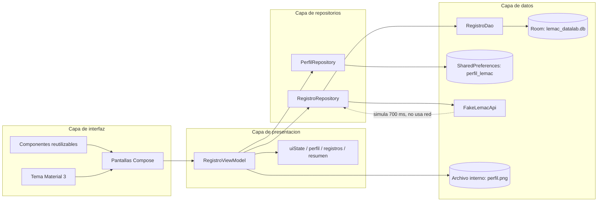
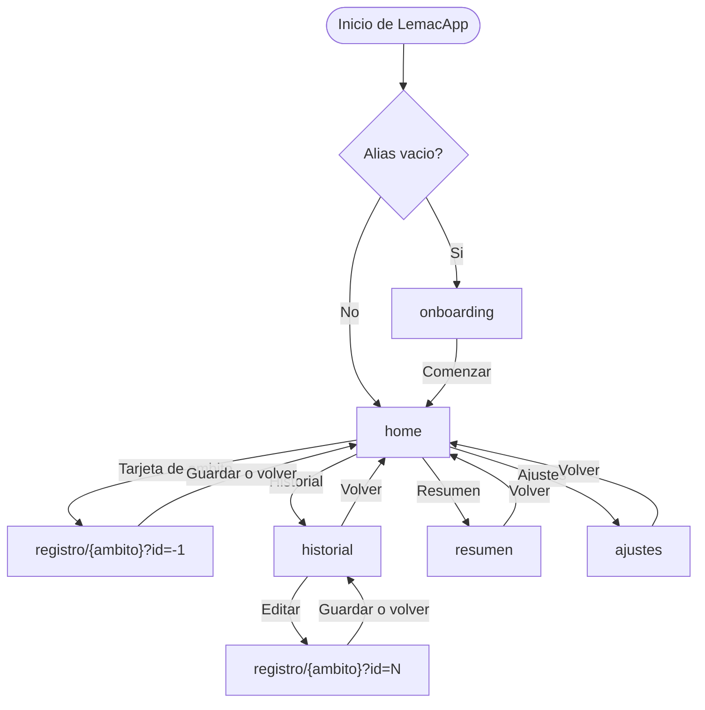
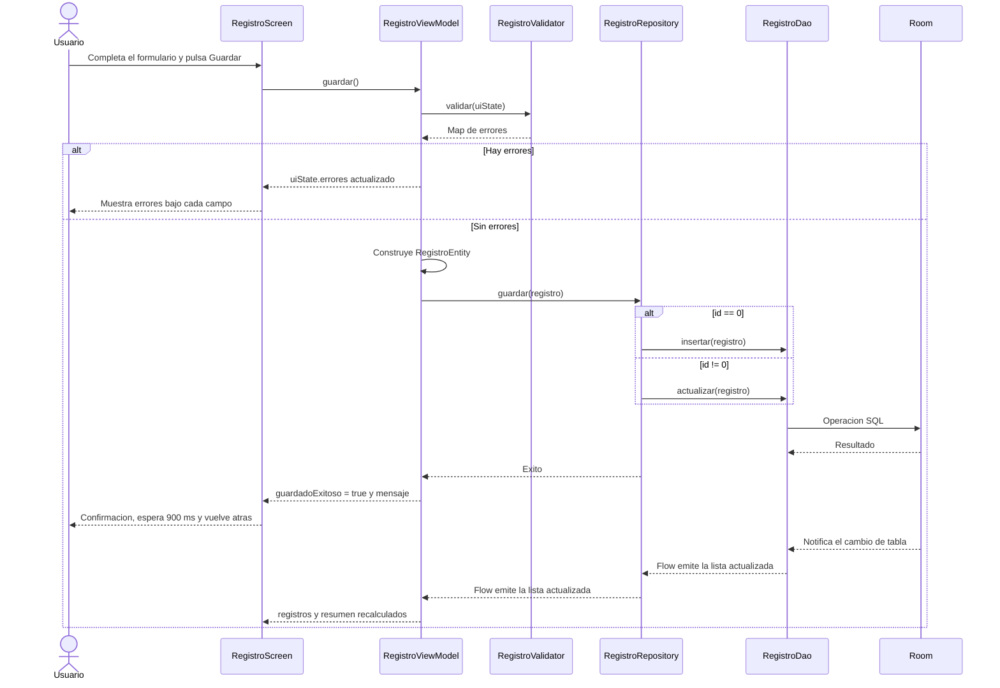
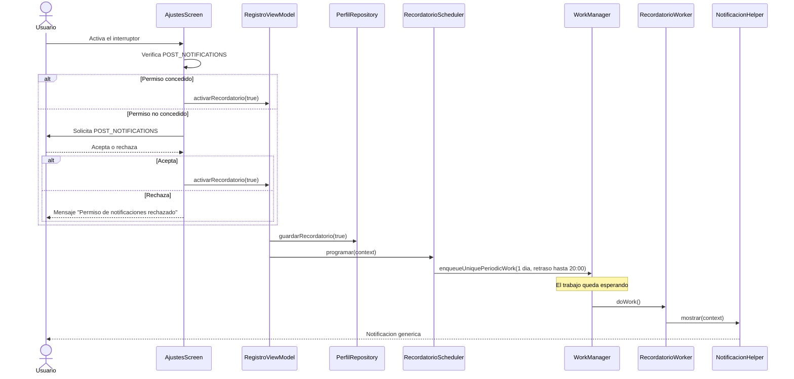
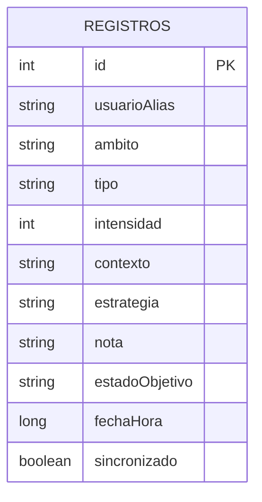

# Guia de estudio de Lemac DataLab

Esta guia explica el proyecto Android `limpio_moviles` tal como esta escrito en el codigo. Sirve para estudiar los componentes, entender el flujo de los datos y preparar una defensa oral.

La regla de lectura es simple: **primero se identifica la capa, despues el archivo, despues la responsabilidad**. No hace falta memorizar cada linea, pero si poder explicar que hace cada pieza y por que esta separada de las demas.

## 1. Vision general

Lemac DataLab es una aplicacion de autorregistro. La persona elige uno de cuatro ambitos, completa un formulario breve, guarda el registro y luego puede verlo en un historial, consultar un resumen por ambito, activar un recordatorio diario y cambiar su alias o foto.

El proyecto es un MVP academico:

- No hay backend real: la sincronizacion es simulada con `FakeLemacApi`.
- No hay autenticacion ni cuentas.
- Los datos se guardan localmente con Room y `SharedPreferences`.
- La app no declara el permiso `INTERNET`.
- Los textos de la interfaz aclaran que se usan datos ficticios o sinteticos y que la app no es diagnostico ni tratamiento.

La aplicacion tiene una sola `Activity` (`MainActivity`) y toda la interfaz se escribe con Jetpack Compose. La navegacion se resuelve con Navigation Compose dentro de un `NavHost`.

## 2. Arquitectura por capas

El proyecto sigue una separacion en capas inspirada en MVVM con un repositorio por fuente de datos. La dependencia va en un solo sentido: la interfaz conoce al ViewModel, el ViewModel conoce a los repositorios y los repositorios conocen las fuentes de datos.



### Responsabilidad de cada capa

| Capa | Archivos principales | Que hace | Que no deberia hacer |
|---|---|---|---|
| Interfaz (UI) | `ui/screens/*`, `ui/components/*`, `ui/theme/*` | Mostrar estado, capturar eventos del usuario, navegar | Acceder directamente a Room o a `SharedPreferences` |
| Presentacion (ViewModel) | `viewmodel/RegistroViewModel.kt` | Mantener estado, validar el formulario, lanzar corrutinas, coordinar repositorios | Conocer detalles de SQL ni construir pantallas |
| Repositorios | `data/repository/*` | Ofrecer operaciones de negocio y ocultar la fuente de datos | Manejar estado de Compose |
| Datos | `data/local/*`, `data/remote/*`, `util/FotoStorage.kt` | Persistir, consultar, simular red y guardar archivos | Decidir textos o navegacion |

### Inyeccion de dependencias manual

No se usa Hilt, Koin ni Dagger. `LemacApplication` actua como contenedor:

- `database` se crea con `by lazy`.
- `registroRepository` recibe el DAO y una instancia de `FakeLemacApi`.
- `perfilRepository` recibe el `Context`.
- `RegistroViewModelFactory` construye el ViewModel con esas dependencias.

Esto es suficiente para un MVP y permite explicar con claridad que dependencias necesita cada pieza.

## 3. Arbol de paquetes y tabla de archivos

```text
com.example.limpio_moviles/
├── LemacApplication.kt
├── MainActivity.kt
├── data/
│   ├── local/
│   │   ├── LemacDatabase.kt
│   │   ├── RegistroDao.kt
│   │   └── RegistroEntity.kt
│   ├── remote/
│   │   └── LemacApi.kt
│   └── repository/
│       ├── PerfilRepository.kt
│       └── RegistroRepository.kt
├── model/
│   ├── Ambito.kt
│   ├── Catalogos.kt
│   ├── PerfilUiState.kt
│   ├── RegistroUiState.kt
│   ├── RegistroValidator.kt
│   ├── ResumenAmbito.kt
│   └── ResumenCalculator.kt
├── navigation/
│   └── AppNavigation.kt
├── ui/
│   ├── components/
│   │   ├── BarraResumen.kt
│   │   ├── ColoresAmbito.kt
│   │   ├── SelectorFotoPerfil.kt
│   │   ├── SelectorIntensidad.kt
│   │   └── TarjetaAmbito.kt
│   ├── screens/
│   │   ├── AjustesScreen.kt
│   │   ├── HistorialScreen.kt
│   │   ├── HomeScreen.kt
│   │   ├── OnboardingScreen.kt
│   │   ├── RegistroScreen.kt
│   │   └── ResumenScreen.kt
│   ├── theme/
│   │   ├── Color.kt
│   │   ├── Theme.kt
│   │   └── Type.kt
│   └── util/
│       └── Formato.kt
├── util/
│   ├── FotoStorage.kt
│   ├── NotificacionHelper.kt
│   ├── RecordatorioScheduler.kt
│   └── RecordatorioWorker.kt
└── viewmodel/
    └── RegistroViewModel.kt
```

### Tabla archivo por archivo

| Archivo | Responsabilidad | Ideas clave |
|---|---|---|
| `LemacApplication.kt` | Punto de entrada de la aplicacion | Crea la base de datos, los repositorios y el canal de notificaciones. Es el contenedor manual de dependencias. |
| `MainActivity.kt` | Unica Activity | Aplica `LemacTheme` y monta `LemacApp()` con `setContent`. |
| `data/local/RegistroEntity.kt` | Entidad Room de la tabla `registros` | Define columnas, clave primaria autoincremental y valores por defecto. |
| `data/local/RegistroDao.kt` | Interfaz de acceso a datos | Consultas `Flow` para observar, `suspend` para obtener, insertar, actualizar, eliminar y marcar sincronizados. |
| `data/local/LemacDatabase.kt` | Base de datos Room | Version 1, una entidad, singleton con `@Volatile` y `synchronized`. |
| `data/remote/LemacApi.kt` | Contrato de sincronizacion y simulacion | `LemacApi` define `sincronizar`; `FakeLemacApi` espera 700 ms y devuelve exito. |
| `data/repository/RegistroRepository.kt` | Repositorio de registros | Expone `Flow`, decide insertar o actualizar, elimina, sincroniza y carga datos demo. |
| `data/repository/PerfilRepository.kt` | Persistencia del perfil | Guarda alias, ruta de foto y estado del recordatorio en `SharedPreferences`. |
| `model/Ambito.kt` | Enumeracion de los cuatro ambitos | Cada valor tiene `etiqueta` y `descripcion`; `desdeNombre` convierte texto a enum con valor por defecto. |
| `model/Catalogos.kt` | Catalogos dependientes del ambito | Tipos disponibles, rango de intensidad, etiquetas de contexto y estrategia. |
| `model/RegistroUiState.kt` | Estado del formulario | Campos del registro, errores por clave, estado de carga, mensaje y bandera de exito. |
| `model/PerfilUiState.kt` | Estado del perfil | Alias, ruta de la foto y si el recordatorio esta activo. |
| `model/RegistroValidator.kt` | Validacion del formulario | Devuelve un `Map<String, String>` con errores; no conoce la UI. |
| `model/ResumenAmbito.kt` | Resultado del resumen por ambito | Cantidad, promedio de intensidad y ultima fecha. |
| `model/ResumenCalculator.kt` | Calculo del resumen | Recorre los cuatro ambitos y calcula sobre la lista de registros. |
| `navigation/AppNavigation.kt` | Rutas, `NavHost` y creacion del ViewModel | Define `Rutas`, decide el destino inicial y conecta pantallas con callbacks. |
| `viewmodel/RegistroViewModel.kt` | Estado y logica de presentacion | Mantiene formulario y perfil, expone `StateFlow`, valida, guarda, elimina, sincroniza y programa recordatorios. |
| `ui/screens/OnboardingScreen.kt` | Primera pantalla | Alias, aviso de privacidad, foto opcional y boton para comenzar. |
| `ui/screens/HomeScreen.kt` | Pantalla principal | Saludo, foto, accesos rapidos, tarjetas de ambito y carga de datos demo cuando no hay registros. |
| `ui/screens/RegistroScreen.kt` | Formulario de registro | Chips de tipo, selector de intensidad, campos, validacion visible, guardado y confirmacion. |
| `ui/screens/HistorialScreen.kt` | Lista de registros | Filtro por ambito, tarjetas, editar, eliminar con dialogo y estado vacio. |
| `ui/screens/ResumenScreen.kt` | Resumen estadistico | Total, promedio y actividad por ambito, mas boton de sincronizacion. |
| `ui/screens/AjustesScreen.kt` | Configuracion | Alias, foto, recordatorio, sincronizacion, datos demo, borrado total y aviso de privacidad. |
| `ui/components/TarjetaAmbito.kt` | Tarjeta de ambito en Home | Icono, color, descripcion y ultimo registro; recibe un callback. |
| `ui/components/BarraResumen.kt` | Barra de actividad | Calcula la fraccion respecto del maximo y anima el ancho. |
| `ui/components/SelectorIntensidad.kt` | Slider de intensidad | Recibe valor, rango y error; muestra extremos bajo y alto. |
| `ui/components/SelectorFotoPerfil.kt` | Captura de foto | Encapsula permisos de camara y `TakePicturePreview`; comparte comportamiento entre pantallas. |
| `ui/components/ColoresAmbito.kt` | Identidad visual | Funciones `colorAmbito` e `iconoAmbito` con `when` exhaustivo. |
| `ui/util/Formato.kt` | Formato de fecha | `dd/MM/yyyy HH:mm` con `Locale.getDefault()`. |
| `util/FotoStorage.kt` | Archivo de foto | Guarda `perfil.png` en `filesDir` y lo carga con `BitmapFactory`. |
| `util/NotificacionHelper.kt` | Notificaciones | Crea el canal, verifica permiso y publica una notificacion generica. |
| `util/RecordatorioScheduler.kt` | Programacion diaria | Usa WorkManager con trabajo periodico unico y retraso inicial hasta las 20:00. |
| `util/RecordatorioWorker.kt` | Ejecucion del recordatorio | `doWork` llama a `NotificacionHelper.mostrar` y devuelve exito. |
| `ui/theme/Color.kt` | Paleta | Colores calmados de Lemac. |
| `ui/theme/Theme.kt` | Tema Material 3 | Esquemas claro y oscuro; no usa color dinamico. |
| `ui/theme/Type.kt` | Tipografia | `Typography()` por defecto de Material 3. |
| `app/src/test/.../RegistroValidatorTest.kt` | Pruebas del validador | 9 casos: tipo, rangos, campos obligatorios y limite de nota. |
| `app/src/test/.../ResumenCalculatorTest.kt` | Pruebas del resumen | 4 casos: lista vacia, promedios, ultima fecha y ambito sin datos. |

## 4. Componentes explicados

### 4.1 Modelo y reglas de negocio

#### `Ambito`

Es un `enum class` con cuatro valores:

| Valor | Etiqueta | Descripcion |
|---|---|---|
| `NEURODESARROLLO` | Neurodesarrollo | Rutinas, tareas y autorregulación |
| `DBT` | Habilidades DBT | Mindfulness, tolerancia, regulación e interpersonal |
| `ANIMO` | Estado de ánimo | Check-in de emoción e intensidad |
| `ADICCIONES` | Adicciones | Impulsos, desencadenantes y acciones protectoras |

`Ambito.desdeNombre(nombre)` busca el valor cuyo `name` coincide y, si no lo encuentra, devuelve `NEURODESARROLLO`. Eso evita excepciones al reconstruir un ambito desde una ruta o desde la base de datos.

#### `Catalogos`

Centraliza lo que cambia segun el ambito:

- `tipos(ambito)`: lista de tipos que se muestran como chips.
- `rangoIntensidad(ambito)`: `0..10` para adicciones y `1..5` para el resto.
- `etiquetaContexto(ambito)`: texto del campo de contexto.
- `etiquetaEstrategia(ambito)`: texto del campo de estrategia.
- `etiquetaNota(ambito)`: siempre "Nota opcional (max. 200 caracteres)".

La ventaja de tenerlo en un objeto es que la UI y el validador consultan la misma fuente. Si se agrega un ambito nuevo, el compilador obliga a completar los `when`.

#### `RegistroUiState`

Es un `data class` inmutable que representa el formulario:

```kotlin
data class RegistroUiState(
    val ambito: Ambito = Ambito.NEURODESARROLLO,
    val tipo: String = "",
    val intensidad: Int = 3,
    val contexto: String = "",
    val estrategia: String = "",
    val nota: String = "",
    val estadoObjetivo: String = "",
    val editandoId: Int? = null,
    val errores: Map<String, String> = emptyMap(),
    val guardadoExitoso: Boolean = false,
    val cargando: Boolean = false,
    val mensaje: String? = null
)
```

Puntos para explicar:

- `editandoId == null` significa registro nuevo; si tiene valor, se esta editando.
- `errores` usa claves como `"tipo"`, `"intensidad"`, `"contexto"`, `"estrategia"` y `"nota"`.
- `guardadoExitoso` dispara la confirmacion y la vuelta atras.
- `cargando` deshabilita el boton de guardar.
- `mensaje` se usa para avisos breves.

#### `PerfilUiState`

Representa el perfil local:

```kotlin
data class PerfilUiState(
    val alias: String = "",
    val fotoPath: String? = null,
    val recordatorioActivo: Boolean = false
)
```

No guarda la imagen en si: guarda la ruta del archivo. El `Bitmap` vivo esta aparte, en `RegistroViewModel.fotoPerfil`, porque es un objeto pesado que no conviene serializar en el estado.

#### `ResumenAmbito`

```kotlin
data class ResumenAmbito(
    val ambito: Ambito,
    val cantidad: Int,
    val promedioIntensidad: Double,
    val ultimaFecha: Long?
)
```

Es la salida del calculo: cuantos registros hay, que promedio de intensidad tienen y cual fue la ultima marca de tiempo. `ultimaFecha` es nullable porque un ambito puede no tener registros.

#### `RegistroValidator`

Es un objeto sin dependencias de Android. Recibe `RegistroUiState` y devuelve un mapa de errores. Reglas exactas:

1. `tipo` no puede estar en blanco.
2. `intensidad` debe pertenecer al rango del ambito.
3. En `ADICCIONES`, `contexto` no puede estar en blanco.
4. En `DBT`, `estrategia` no puede estar en blanco.
5. En `NEURODESARROLLO`, `estrategia` no puede estar en blanco.
6. `nota` no puede superar 200 caracteres.

No valida `estadoObjetivo` porque es opcional. Tampoco valida un minimo de contexto o estrategia en los ambitos donde son opcionales.

#### `ResumenCalculator`

Recorre `Ambito.entries` y, para cada ambito, filtra los registros cuyo `ambito` coincide con `ambito.name`. Calcula:

- `cantidad`: tamano de la lista filtrada.
- `promedioIntensidad`: suma de intensidades dividida entre la cantidad; `0.0` si no hay registros.
- `ultimaFecha`: maximo de `fechaHora`; `null` si no hay registros.

Es una funcion pura: no toca base de datos ni Android, por eso se puede probar con JUnit sin emulador.

### 4.2 Capa de datos

#### `RegistroEntity`

Es la tabla `registros`. Columnas:

| Columna | Tipo | Uso |
|---|---|---|
| `id` | `Int` | Clave primaria autoincremental; `0` significa "nuevo" |
| `usuarioAlias` | `String` | Alias del perfil al momento de guardar |
| `ambito` | `String` | Nombre del enum, por ejemplo `"DBT"` |
| `tipo` | `String` | Tipo elegido del catalogo |
| `intensidad` | `Int` | Valor dentro del rango del ambito |
| `contexto` | `String` | Situacion o desencadenante |
| `estrategia` | `String` | Habilidad o accion protectora |
| `nota` | `String` | Texto libre, maximo 200 |
| `estadoObjetivo` | `String` | Solo se usa en adicciones |
| `fechaHora` | `Long` | Marca de tiempo en milisegundos |
| `sincronizado` | `Boolean` | Indica si ya se marco como sincronizado |

Room convierte automaticamente entre `Boolean` y columna SQLite. No hay relaciones con otras tablas.

#### `RegistroDao`

Es una interfaz anotada con `@Dao`. Metodos:

| Metodo | Tipo | Consulta |
|---|---|---|
| `observarTodos()` | `Flow<List<RegistroEntity>>` | Todos, ordenados por `fechaHora DESC` |
| `observarPorAmbito(ambito)` | `Flow<List<RegistroEntity>>` | Filtrados por ambito, ordenados por fecha |
| `obtenerPorId(id)` | `suspend` | Un registro por id |
| `obtenerPendientes()` | `suspend` | Los que tienen `sincronizado = 0` |
| `insertar(registro)` | `suspend` | Devuelve el id generado |
| `actualizar(registro)` | `suspend` | Actualiza la fila completa |
| `eliminar(registro)` | `suspend` | Borra por entidad |
| `marcarSincronizados(ids)` | `suspend` | `UPDATE ... WHERE id IN (:ids)` |
| `eliminarTodos()` | `suspend` | `DELETE FROM registros` |

La clave tecnica es que las consultas de lectura reactiva devuelven `Flow`. Room emite una nueva lista cada vez que cambia la tabla, sin que el ViewModel tenga que refrescar manualmente.

#### `LemacDatabase`

Base de datos Room:

- Entidad: `RegistroEntity`.
- Version: `1`.
- `exportSchema = false`.
- Nombre del archivo: `lemac_datalab.db`.
- Singleton con `INSTANCE`, `@Volatile`, `synchronized` y `Room.databaseBuilder`.
- Usa `fallbackToDestructiveMigration()`.

`fallbackToDestructiveMigration()` significa que si cambia la version sin migracion, Room borra y recrea la base. Es aceptable en un MVP, pero en produccion se deben escribir migraciones para no perder datos.

#### `LemacApi` y `FakeLemacApi`

`LemacApi` es una interfaz con un solo metodo:

```kotlin
suspend fun sincronizar(registros: List<RegistroEntity>): Result<Unit>
```

`FakeLemacApi` implementa ese contrato: espera 700 ms con `delay(700)` y devuelve `Result.success(Unit)`. No envia nada por la red, no usa Retrofit ni OkHttp y no necesita el permiso `INTERNET`.

Para la defensa conviene decir: "La interfaz permite sustituir la simulacion por una implementacion real sin cambiar el repositorio ni el ViewModel". Es un ejemplo de inversion de dependencias aplicada de forma sencilla.

#### `RegistroRepository`

Es la fachada de los registros. Recibe `RegistroDao` y `LemacApi` (por defecto `FakeLemacApi()`).

- `registros`: expone el `Flow` del DAO.
- `observarPorAmbito(ambito)`: delega la consulta filtrada. La UI actual no la usa, pero queda disponible.
- `guardar(registro)`: si `id == 0` inserta; si no, actualiza.
- `eliminar(registro)`: borra la entidad.
- `obtener(id)`: busca por id.
- `eliminarTodos()`: borra toda la tabla.
- `sincronizar()`: obtiene pendientes; si no hay, devuelve `0`; si hay, llama a la API, marca los ids como sincronizados y devuelve la cantidad.
- `cargarDemo(alias)`: si la base ya tiene registros, no hace nada; si esta vacia, inserta cuatro registros de ejemplo.

El repositorio es el lugar donde vive la decision "insertar o actualizar" y la coordinacion entre Room y la API.

#### `PerfilRepository`

Usa `SharedPreferences` con nombre `perfil_lemac`. Claves:

- `alias`
- `foto_path`
- `recordatorio_activo`

Metodos: `cargarAlias`, `guardarAlias`, `cargarFotoPath`, `guardarFotoPath`, `cargarRecordatorio`, `guardarRecordatorio`. Todas las escrituras usan `apply()`, que es asincrono y no bloquea la interfaz.

### 4.3 ViewModel

#### `RegistroViewModel`

Extiende `AndroidViewModel` porque necesita un `Application` para acceder al contexto al guardar la foto y programar recordatorios. Recibe ademas `RegistroRepository` y `PerfilRepository`.

Estado que expone:

| Propiedad | Tipo | Proposito |
|---|---|---|
| `uiState` | `mutableStateOf(RegistroUiState())` | Formulario y mensajes |
| `perfil` | `mutableStateOf(PerfilUiState())` | Alias, foto y recordatorio |
| `fotoPerfil` | `mutableStateOf<Bitmap?>(null)` | Imagen ya decodificada para Compose |
| `registros` | `StateFlow<List<RegistroEntity>>` | Lista reactiva de Room |
| `resumen` | `StateFlow<List<ResumenAmbito>>` | Resumen derivado de los registros |

En el `init`:

1. Lee alias, ruta de foto y estado del recordatorio desde `PerfilRepository`.
2. Construye `PerfilUiState`.
3. Carga el `Bitmap` desde la ruta con `FotoStorage.cargar`.

Metodos importantes:

- `guardarAlias(alias)`: recorta espacios, actualiza estado y guarda en preferencias.
- `actualizarFoto(bitmap)`: guarda el PNG, actualiza `fotoPerfil` y la ruta en preferencias.
- `activarRecordatorio(activo)`: guarda la preferencia y programa o cancela el trabajo.
- `prepararFormulario(ambito, id)`: deja el formulario listo; si hay id, carga el registro.
- `cambiarAmbito(ambito)`: reinicia tipo, ajusta intensidad al primer valor del rango y limpia errores.
- `actualizarTipo/Intensidad/Contexto/Estrategia/Nota/EstadoObjetivo`: actualizan un campo y eliminan el error correspondiente.
- `guardar()`: valida, construye la entidad y llama al repositorio.
- `eliminar(registro)`: borra y publica un mensaje.
- `sincronizar()`: llama al repositorio y publica cuantos registros proceso.
- `cargarDemo()`: inserta datos de ejemplo si la base esta vacia.
- `borrarTodos()`: elimina todos los registros.
- `limpiarMensaje()`, `limpiarFormulario()`, `mostrarMensaje()`: utilidades de estado.

Detalle importante de `guardar()`: siempre construye la entidad con `fechaHora = System.currentTimeMillis()` y `sincronizado = false`. Por eso, al editar un registro, la fecha se actualiza y el registro vuelve a quedar pendiente de sincronizacion.

#### `RegistroViewModelFactory`

Implementa `ViewModelProvider.Factory`. Verifica que la clase solicitada sea `RegistroViewModel` y la construye con `Application`, `RegistroRepository` y `PerfilRepository`. Si recibe otra clase, lanza `IllegalArgumentException`.

Se usa porque el ViewModel tiene parametros en el constructor y `viewModel()` no puede crearlo por defecto.

### 4.4 Aplicacion y navegacion

#### `LemacApplication`

Es la clase declarada en `android:name` del manifiesto. En `onCreate()` crea el canal de notificaciones. Expone de forma perezosa:

- `database`
- `registroRepository`
- `perfilRepository`

Es el punto donde se ve la inyeccion manual de dependencias.

#### `MainActivity`

Extiende `ComponentActivity`. En `onCreate` llama a `setContent` y monta:

```kotlin
LemacTheme {
    LemacApp()
}
```

No hay fragments, ni multiples activities, ni XML de layout.

#### `AppNavigation` y `Rutas`

`Rutas` define las cadenas de navegacion:

| Constante | Valor |
|---|---|
| `ONBOARDING` | `"onboarding"` |
| `HOME` | `"home"` |
| `HISTORIAL` | `"historial"` |
| `RESUMEN` | `"resumen"` |
| `AJUSTES` | `"ajustes"` |
| `REGISTRO_PATRON` | `"registro/{ambito}?id={id}"` |

La funcion `Rutas.registro(ambito, id)` arma la ruta concreta, por ejemplo `registro/DBT?id=-1` para un registro nuevo o `registro/ANIMO?id=7` para editar.

`LemacApp()`:

1. Obtiene el `Context` y lo castea a `LemacApplication`.
2. Crea una sola vez la `RegistroViewModelFactory` con `remember`.
3. Obtiene el ViewModel con `viewModel(factory = factory)`.
4. Crea el `NavHost`.
5. Decide el destino inicial: `ONBOARDING` si `perfil.alias` esta en blanco; `HOME` si ya hay alias.

El ViewModel se crea en `LemacApp`, no dentro de cada destino. Por eso **todas las pantallas comparten la misma instancia** y el estado sobrevive a la navegacion. Es una decision util para un MVP, aunque tambien implica que `uiState` es compartido y cada pantalla debe preparar el formulario cuando corresponde.

### 4.5 Pantallas

#### `OnboardingScreen`

Objetivo: presentar la app, pedir alias, aceptar el aviso de privacidad y permitir una foto opcional.

- Estado local con `rememberSaveable`: `alias`, `aceptaPrivacidad`, `errorAlias`.
- Valida que el alias tenga al menos 3 caracteres.
- El boton "Comenzar" se habilita solo si el alias es valido y el checkbox esta marcado.
- Muestra los cuatro ambitos con su icono, color y descripcion.
- Usa `SelectorFotoPerfil`; la foto es opcional.
- Al confirmar: `viewModel.guardarAlias(alias)` y `onFinalizar()`.
- La navegacion hace `popUpTo(ONBOARDING) { inclusive = true }` para que no se pueda volver con el boton atras al onboarding.

No guarda nada hasta pulsar "Comenzar". Si la persona cierra la app antes, el alias no queda persistido (aunque una foto capturada si se guarda en disco y en preferencias).

#### `HomeScreen`

Objetivo: punto central de navegacion.

- Saludo con alias y foto, o icono de persona si no hay foto.
- Tres accesos rapidos: Historial, Resumen, Ajustes.
- Una `TarjetaAmbito` por cada `Ambito.entries`.
- Para cada tarjeta busca el primer registro de ese ambito en la lista ordenada por fecha descendente. Ese es el "ultimo registro".
- Si no hay registros, muestra una tarjeta con el boton "Cargar datos de ejemplo".
- Usa `collectAsStateWithLifecycle` para la lista.
- Muestra mensajes del ViewModel con `Snackbar`.

#### `RegistroScreen`

Objetivo: crear o editar un registro.

- Recibe `ambito` e `id` desde la ruta.
- `LaunchedEffect(ambito, id)` llama a `prepararFormulario`.
- `LaunchedEffect(Unit)` limpia mensajes viejos al entrar.
- Muestra chips con `Catalogos.tipos(ambito)`.
- Muestra `SelectorIntensidad` con el rango del ambito.
- Campos de contexto y estrategia con etiquetas dinamicas.
- El campo "Estado del objetivo" solo aparece en `ADICCIONES`.
- La nota se corta en 200 caracteres desde `onValueChange`, ademas de la validacion del modelo.
- Los errores se muestran debajo de cada campo o seccion.
- Al guardar correctamente, muestra una tarjeta de confirmacion, espera 900 ms, limpia el formulario y vuelve atras.
- Si `cargando` es true, el boton se deshabilita y muestra "Guardando...".

#### `HistorialScreen`

Objetivo: listar, filtrar, editar y eliminar.

- `filtro` es estado local (`Ambito?`); `null` significa "Todos".
- `filtrados` se calcula con `remember(registros, filtro)`.
- Si no hay resultados, distingue entre "no hay ningun registro" y "no hay registros en este ambito".
- Cada registro se muestra en `TarjetaRegistro` con color e icono del ambito, fecha formateada, intensidad, tipo y campos opcionales.
- "Editar" llama a `onEditar(registro)`, que navega al formulario con el id.
- "Eliminar" abre un `AlertDialog`; solo al confirmar llama a `viewModel.eliminar`.
- Los mensajes se muestran con `Toast`.

#### `ResumenScreen`

Objetivo: mostrar estadisticas simples.

- Tarjeta superior con el total de registros.
- Una tarjeta por ambito con cantidad, promedio y ultima fecha.
- `maximo` es la mayor cantidad entre los cuatro ambitos; se usa para escalar las barras.
- `BarraResumen` recibe cantidad, promedio, maximo y color.
- Boton "Sincronizar" que llama al ViewModel y cambia el texto mientras carga.
- Nota al pie: los promedios se calculan sobre los registros guardados en el dispositivo.

#### `AjustesScreen`

Objetivo: configurar perfil, recordatorios y datos.

Secciones:

1. **Perfil**: editar alias con minimo 3 caracteres, guardar y cambiar foto.
2. **Recordatorios**: interruptor de recordatorio diario a las 20:00. Antes de activar verifica `POST_NOTIFICATIONS`.
3. **Datos**: sincronizar, cargar datos de ejemplo y borrar todos los registros con dialogo de confirmacion.
4. **Privacidad**: texto que recuerda que es un MVP con datos ficticios, que no es diagnostico y que la informacion se guarda en el dispositivo.

La foto usa el mismo `SelectorFotoPerfil` que Onboarding. El alias se guarda solo al pulsar "Guardar alias".

### 4.6 Componentes reutilizables

#### `TarjetaAmbito`

Tarjeta clickeable de Home. Recibe `ambito`, `ultimoRegistro` y `onClick`. Usa `colorAmbito` e `iconoAmbito`, muestra la descripcion y una linea con el ultimo tipo y fecha, o "Sin registros". El `clickable` tiene `role = Role.Button` para accesibilidad.

#### `BarraResumen`

Muestra una barra horizontal animada. La fraccion es `cantidad / maximo`, acotada entre 0 y 1. Si `maximo <= 0`, la fraccion es 0 para evitar division por cero. Usa `animateFloatAsState` y agrega una descripcion semantica con cantidad y promedio.

#### `SelectorIntensidad`

Combina un texto "Intensidad: N", un `Slider` y etiquetas de extremos. El `valueRange` viene del rango del ambito. `steps` se calcula como `rango.last - rango.first - 1`, con minimo 0. Redondea el valor del slider a entero. Si recibe un error, lo muestra debajo.

#### `SelectorFotoPerfil`

Encapsula dos launchers:

- `TakePicturePreview`: devuelve un `Bitmap` de vista previa.
- `RequestPermission`: solicita `CAMERA`.

Primero verifica si el permiso ya esta concedido; si no, lo solicita. Si se concede, abre la camara. Si se deniega, llama a `onPermisoDenegado`. La imagen se muestra en un circulo de 104 dp. No usa galeria ni permisos de almacenamiento.

#### `ColoresAmbito`

Dos funciones exhaustivas sobre `Ambito`:

| Ambito | Color | Icono |
|---|---|---|
| Neurodesarrollo | `VerdeLemac` | `Psychology` |
| DBT | `AzulLemac` | `SelfImprovement` |
| Animo | `NaranjaLemac` | `Mood` |
| Adicciones | `MoradoLemac` | `Warning` |

Si se agrega un ambito nuevo, el `when` deja de compilar hasta que se complete. Es una proteccion util.

### 4.7 Utilidades

#### `FotoStorage`

Guarda la foto como `perfil.png` en `context.filesDir` con compresion PNG al 100 por ciento y devuelve la ruta absoluta. Para cargar, verifica que la ruta no sea nula ni vacia y que el archivo exista; si no, devuelve `null`. No usa almacenamiento externo.

#### `NotificacionHelper`

- `CANAL_ID = "recordatorios_lemac"`.
- `ID_NOTIFICACION = 1001`.
- `crearCanal(context)`: crea un `NotificationChannel` con importancia `IMPORTANCE_DEFAULT` y textos de `strings.xml`. Solo actua en Android 8 o superior; como `minSdk` es 33, siempre se cumple.
- `mostrar(context)`: verifica permiso en Android 13 o superior, construye una notificacion con icono, titulo y texto generico, y la publica con `NotificationManagerCompat`.
- `puedeNotificar(context)`: comprueba `POST_NOTIFICATIONS`.

El texto de la notificacion no incluye datos del registro. Eso es coherente con el aviso de privacidad.

#### `RecordatorioScheduler`

- Trabajo unico: `"recordatorio_diario_lemac"`.
- Hora fija: 20:00 (`HORA_RECORDATORIO = 20`).
- Calcula el proximo horario: si las 20:00 de hoy ya pasaron, usa las 20:00 de manana.
- Crea un `PeriodicWorkRequest` de 1 dia con `setInitialDelay`.
- Lo encola con `enqueueUniquePeriodicWork` y politica `UPDATE`.
- `cancelar` llama a `cancelUniqueWork`.

WorkManager no garantiza precision exacta al milisegundo: puede retrasar la ejecucion por optimizaciones del sistema, bateria o Doze. Para la defensa conviene decir "recordatorio diario aproximado a las 20:00", no "alarma exacta".

#### `RecordatorioWorker`

Extiende `Worker`. En `doWork()` llama a `NotificacionHelper.mostrar(applicationContext)` y devuelve `Result.success()`. No hace trabajo pesado ni accede a la base de datos.

#### `Formato`

`formatearFecha(fechaHora)` usa `SimpleDateFormat("dd/MM/yyyy HH:mm", Locale.getDefault())`. Se usa en Home, Historial y Resumen. Al usar el locale del dispositivo, el formato puede variar en la practica; el patron base es dia/mes/anio y hora de 24 horas.

### 4.8 Tema

- `Color.kt` define la paleta: `VerdeLemac`, `VerdeClaro`, `ArenaLemac`, `SuperficieOscura`, `TextoOscuro`, `GrisTexto`, `NaranjaLemac`, `AzulLemac`, `MoradoLemac`.
- `Theme.kt` define `EsquemaClaro` y `EsquemaOscuro` con `lightColorScheme` y `darkColorScheme`. No usa color dinamico (`dynamicColor`), por lo que la identidad visual es fija.
- `LemacTheme` elige el esquema segun `isSystemInDarkTheme()` y aplica `Typography`.
- `Type.kt` usa `Typography()` por defecto.
- Los colores por ambito son independientes del tema y se aplican con `colorAmbito`.

## 5. Diagramas

### 5.1 Grafo de navegacion



Observacion: el formulario vuelve con `popBackStack()`. Por eso, si se abrio desde Home, vuelve a Home; si se abrio desde Historial, vuelve a Historial.

### 5.2 Diagrama de secuencia: guardar un registro



La ultima parte es la clave reactiva: Room notifica el cambio a traves del `Flow`; `registros` y `resumen` se actualizan sin que la pantalla vuelva a consultar manualmente.

### 5.3 Diagrama de secuencia: recordatorio diario



Si el interruptor se apaga, el flujo es mas corto: `activarRecordatorio(false)` guarda `false` y `RecordatorioScheduler.cancelar` ejecuta `cancelUniqueWork`.

### 5.4 Modelo Room



Hay una sola tabla y no hay relaciones foraneas. `id = 0` se usa en memoria para indicar un registro nuevo; Room genera el id real al insertar.

## 6. Flujos detallados paso a paso

### 6.1 Onboarding

1. `MainActivity` monta `LemacApp()` dentro de `LemacTheme`.
2. `LemacApp` crea el ViewModel. En su `init`, el ViewModel lee el alias de `PerfilRepository`.
3. Si el alias esta vacio, el destino inicial es `onboarding`.
4. `OnboardingScreen` mantiene alias, checkbox y error con `rememberSaveable`.
5. La persona puede tomar una foto opcional con `SelectorFotoPerfil`; si la toma, el ViewModel la guarda en disco y en preferencias.
6. El boton "Comenzar" esta deshabilitado hasta que el alias tenga al menos 3 caracteres y el checkbox de privacidad este marcado.
7. Al pulsar, `guardarAlias` recorta el alias, actualiza `perfil` y guarda en `SharedPreferences`.
8. `onFinalizar` navega a `home` con `popUpTo(onboarding) { inclusive = true }`.
9. A partir de ese momento, en futuros arranques el destino inicial sera `home` porque el alias ya no esta vacio.

### 6.2 Guardar un registro nuevo

1. En Home, el usuario toca una `TarjetaAmbito`.
2. Se navega a `Rutas.registro(ambito)`, que genera `registro/AMBITO?id=-1`.
3. `AppNavigation` parsea el ambito con `Ambito.desdeNombre` y convierte `id = -1` en `null`.
4. `RegistroScreen` ejecuta `prepararFormulario(ambito, null)` y el ViewModel crea `RegistroUiState(ambito = ambito)`.
5. El usuario elige un tipo en los chips y ajusta la intensidad.
6. Completa contexto, estrategia, estado objetivo (solo adicciones) y nota.
7. Cada cambio llama a un metodo `actualizar...` que hace `copy` del estado y elimina el error de ese campo.
8. Al pulsar "Guardar registro", `guardar()` llama a `RegistroValidator.validar`.
9. Si hay errores, se copian al estado y la pantalla los muestra. No se toca la base de datos.
10. Si no hay errores, se construye `RegistroEntity` con `id = 0`, alias actual (o `"Usuario de prueba"` si esta vacio), cadenas recortadas, `fechaHora = ahora` y `sincronizado = false`.
11. `RegistroRepository.guardar` ve `id == 0` y ejecuta `dao.insertar`.
12. Room inserta y notifica a los `Flow`; `registros` y `resumen` se actualizan.
13. El ViewModel marca `guardadoExitoso = true`, `cargando = false` y un mensaje.
14. La pantalla muestra la tarjeta de confirmacion, espera 900 ms, limpia el formulario y hace `popBackStack`.
15. Home vuelve a mostrarse con el nuevo registro como "ultimo" en su ambito.

### 6.3 Editar un registro

1. En Historial, "Editar" llama a `onEditar(registro)`.
2. `AppNavigation` navega a `Rutas.registro(ambito, registro.id)`.
3. `RegistroScreen` ejecuta `prepararFormulario(ambito, id)`.
4. El ViewModel pone `cargando = true` y lanza una corrutina en `viewModelScope`.
5. `RegistroRepository.obtener(id)` consulta `dao.obtenerPorId(id)`.
6. Si encuentra el registro, copia todos sus campos a `RegistroUiState` y guarda `editandoId = id`.
7. Si no lo encuentra (por ejemplo, fue eliminado), deja un formulario vacio con el ambito recibido. En ese caso, guardar crearia un registro nuevo.
8. El usuario modifica y guarda.
9. `registroRepository.guardar` ve `id != 0` y ejecuta `dao.actualizar`.
10. La entidad se guarda con la fecha actual y `sincronizado = false`; es decir, la edicion cambia la fecha y vuelve a marcar el registro como pendiente.
11. Se muestra "Registro actualizado" y se vuelve a Historial.

### 6.4 Eliminar un registro

1. En Historial, "Eliminar" no borra de inmediato: guarda el registro en `registroAEliminar`.
2. Se muestra un `AlertDialog` con el ambito y la advertencia de que no se puede deshacer.
3. "Cancelar" limpia `registroAEliminar`.
4. "Eliminar" llama a `viewModel.eliminar(registro)` y cierra el dialogo.
5. El ViewModel lanza la corrutina, llama a `registroRepository.eliminar` y este a `dao.eliminar`.
6. Room notifica el cambio; la lista se actualiza y la tarjeta desaparece.
7. El ViewModel publica "Registro eliminado" y la pantalla lo muestra con `Toast`.

### 6.5 Ver historial y filtrar

1. `HistorialScreen` obtiene `registros` con `collectAsStateWithLifecycle`.
2. El filtro local empieza en `null` ("Todos").
3. Los chips muestran "Todos" y un chip por cada `Ambito.entries`.
4. `filtrados` se recalcula cuando cambian los registros o el filtro.
5. Si la lista filtrada esta vacia, se muestra un estado vacio distinto segun si la base entera esta vacia o solo ese ambito.
6. Si hay datos, se dibuja un `LazyColumn` con `TarjetaRegistro`.
7. Cada tarjeta muestra color, icono, fecha, intensidad, tipo y solo los campos no vacios.
8. Las acciones Editar y Eliminar estan al pie de cada tarjeta.

### 6.6 Ver resumen

1. `ResumenScreen` obtiene `resumen` y `registros`.
2. `resumen` viene de `RegistroRepository.registros.map { ResumenCalculator.calcular(it) }`.
3. `ResumenCalculator` recorre los cuatro ambitos y calcula cantidad, promedio y ultima fecha.
4. La pantalla muestra el total de registros.
5. Calcula `maximo` como la mayor cantidad entre los ambitos.
6. Por cada ambito dibuja una tarjeta con promedio, ultima fecha y `BarraResumen`.
7. La barra compara la cantidad del ambito contra el maximo, no contra la intensidad.
8. Si no hay registros, todas las barras quedan en cero y las fechas muestran "sin registros".

### 6.7 Sincronizar con la API simulada

1. El usuario pulsa "Sincronizar" en Resumen o Ajustes.
2. `viewModel.sincronizar()` pone `cargando = true`.
3. `RegistroRepository.sincronizar()` pide los registros con `sincronizado = 0`.
4. Si no hay pendientes, devuelve `0` sin llamar a la API.
5. Si hay pendientes, llama a `FakeLemacApi.sincronizar`, que espera 700 ms y devuelve exito.
6. El repositorio marca esos ids con `dao.marcarSincronizados`.
7. Devuelve la cantidad y el ViewModel muestra "Sincronizados N registros" o "No hay registros pendientes".
8. Si la llamada falla, se muestra "No se pudo sincronizar" y no se marca nada.

Aclaracion importante: la sincronizacion es **simulada**. Los datos no salen del dispositivo. El campo `sincronizado` es una bandera local.

### 6.8 Activar el recordatorio

1. En Ajustes, el interruptor refleja `viewModel.perfil.recordatorioActivo`.
2. Al activarlo, la pantalla verifica `POST_NOTIFICATIONS`.
3. Si ya esta concedido, llama a `viewModel.activarRecordatorio(true)`.
4. Si no, lanza el permiso. Si se concede, activa; si se rechaza, muestra un mensaje y el interruptor queda apagado.
5. `activarRecordatorio(true)` actualiza el estado, guarda la preferencia y llama a `RecordatorioScheduler.programar`.
6. El scheduler calcula el proximo 20:00, crea un trabajo periodico de un dia y lo encola como trabajo unico.
7. Cuando WorkManager ejecuta el worker, `RecordatorioWorker.doWork()` llama a `NotificacionHelper.mostrar`.
8. `NotificacionHelper` verifica el permiso, construye la notificacion y la publica en el canal `recordatorios_lemac`.
9. Al apagar el interruptor se guarda `false` y se cancela el trabajo unico.

### 6.9 Foto de perfil

1. `SelectorFotoPerfil` verifica el permiso `CAMERA`.
2. Si esta concedido, lanza `TakePicturePreview`; si no, solicita el permiso.
3. Si el permiso se concede, se abre la camara; si se deniega, se llama a `onPermisoDenegado`.
4. Si la captura devuelve un `Bitmap`, se llama a `onFotoCapturada`.
5. En Onboarding y Ajustes, ese callback es `viewModel.actualizarFoto(it)`.
6. El ViewModel guarda el PNG en `filesDir/perfil.png` con `FotoStorage.guardar`.
7. Actualiza `fotoPerfil` (para que Compose la muestre) y `perfil.fotoPath`.
8. Guarda la ruta en `SharedPreferences`.
9. En el siguiente arranque, el `init` del ViewModel lee la ruta y carga el `Bitmap` con `FotoStorage.cargar`.

No hay permiso de almacenamiento porque la imagen se guarda en el directorio interno de la app y la camara devuelve una vista previa en memoria.

### 6.10 Cargar y borrar datos demo

Cargar:

1. El boton aparece en Home cuando no hay registros, y tambien en Ajustes.
2. `viewModel.cargarDemo()` lanza la corrutina y usa el alias actual o `"Usuario de prueba"`.
3. `RegistroRepository.cargarDemo(alias)` consulta la primera emision de `observarTodos()`.
4. Si ya hay al menos un registro, retorna sin insertar nada.
5. Si la base esta vacia, inserta cuatro registros, uno por ambito, con fechas de hace 1, 2, 3 y 4 dias y `sincronizado = false`.
6. El ViewModel muestra "Datos de demostracion cargados". Si la base no estaba vacia, el mensaje se muestra igual aunque no se haya insertado nada; es una limitacion conocida del MVP.

Borrar:

1. En Ajustes, "Borrar todos los registros" abre un dialogo.
2. Al confirmar, `viewModel.borrarTodos()` llama a `registroRepository.eliminarTodos()`.
3. El DAO ejecuta `DELETE FROM registros`.
4. Se muestra "Registros eliminados".
5. No se borran el alias, la foto ni el estado del recordatorio; solo los registros.

## 7. Reglas de validacion por ambito

### Tipos disponibles

| Ambito | Tipos exactos del codigo |
|---|---|
| Neurodesarrollo | Rutina, Tarea, Sobrecarga, Autorregulación |
| DBT | Mindfulness, Tolerancia al malestar, Regulación emocional, Efectividad interpersonal |
| Animo | Feliz, Tranquilo, Neutro, Ansioso, Triste, Irritable |
| Adicciones | Craving, Impulso, Recaída, Objetivo cumplido |

### Campos y rangos

| Ambito | Rango de intensidad | Tipo | Contexto | Estrategia | Estado objetivo | Nota |
|---|---|---|---|---|---|---|
| Neurodesarrollo | 1 a 5 | Obligatorio | Opcional | Obligatoria | No se muestra | Maximo 200 |
| DBT | 1 a 5 | Obligatorio | Opcional | Obligatoria | No se muestra | Maximo 200 |
| Animo | 1 a 5 | Obligatorio | Opcional | Opcional | No se muestra | Maximo 200 |
| Adicciones | 0 a 10 | Obligatorio | Obligatorio | Opcional | Opcional | Maximo 200 |

### Mensajes exactos del validador

| Clave | Condicion | Mensaje |
|---|---|---|
| `tipo` | Texto en blanco | "Selecciona un tipo" |
| `intensidad` | Fuera del rango | "La intensidad debe estar entre X y Y" |
| `contexto` | Adicciones sin contexto | "Indica el desencadenante" |
| `estrategia` | DBT sin estrategia | "Indica la habilidad practicada" |
| `estrategia` | Neurodesarrollo sin estrategia | "Indica la estrategia utilizada" |
| `nota` | Mas de 200 caracteres | "La nota no puede superar 200 caracteres" |

La interfaz, ademas, impide escribir mas de 200 caracteres en la nota y valida el alias con minimo 3 caracteres (esta ultima regla vive en las pantallas, no en `RegistroValidator`).

## 8. Estados y ciclo de vida

### Dos mecanismos de estado

| Mecanismo | Donde se usa | Para que |
|---|---|---|
| `mutableStateOf` | `uiState`, `perfil`, `fotoPerfil` en el ViewModel | Estado de Compose que debe provocar recomposicion |
| `StateFlow` | `registros`, `resumen` | Flujo reactivo derivado de Room, con ciclo de vida y valor inicial |

No son alternativas excluyentes: se usan para problemas distintos.

### `mutableStateOf` en el ViewModel

```kotlin
var uiState by mutableStateOf(RegistroUiState())
    private set
```

- `by` usa el delegado de Compose.
- `private set` impide que la UI reemplace el estado directamente; solo el ViewModel lo modifica.
- Cada `copy` crea un objeto nuevo, lo que ayuda a que Compose detecte el cambio.
- La UI lee `viewModel.uiState` y se recompone cuando cambia.

### `StateFlow` y `stateIn`

```kotlin
val registros: StateFlow<List<RegistroEntity>> = registroRepository.registros
    .stateIn(
        scope = viewModelScope,
        started = SharingStarted.WhileSubscribed(5_000),
        initialValue = emptyList()
    )
```

- `registroRepository.registros` es un `Flow` de Room.
- `stateIn` lo convierte en `StateFlow` con un valor inicial.
- `SharingStarted.WhileSubscribed(5_000)` mantiene la recoleccion activa mientras haya suscriptores y durante 5 segundos despues de que el ultimo se desconecte. Asi se evita reiniciar la consulta por cambios de configuracion.
- `viewModelScope` asegura que la recoleccion se cancele cuando el ViewModel se destruya.
- `resumen` hace un `map` sobre el mismo flujo y aplica `ResumenCalculator.calcular`.

### `collectAsStateWithLifecycle`

Home, Historial y Resumen usan:

```kotlin
val registros by viewModel.registros.collectAsStateWithLifecycle()
```

Esta funcion convierte el `StateFlow` en estado de Compose y **suspende la recoleccion cuando la pantalla no esta visible** (por ejemplo, en segundo plano). Es la forma recomendada frente a `collectAsState`, porque respeta el ciclo de vida.

### `viewModelScope`

Todas las operaciones que pueden tardar se lanzan con `viewModelScope.launch`:

- Guardar un registro.
- Eliminar.
- Sincronizar.
- Cargar datos demo.
- Borrar todos.
- Cargar un registro para editar.

Si el ViewModel se destruye, las corrutinas se cancelan. Las funciones `suspend` del DAO se ejecutan sin bloquear el hilo principal.

### Estado local de pantalla

| Pantalla | Estado | Herramienta | Motivo |
|---|---|---|---|
| Onboarding | `alias`, `aceptaPrivacidad`, `errorAlias` | `rememberSaveable` | Sobrevive a rotacion y no necesita el ViewModel |
| Historial | `filtro`, `registroAEliminar` | `remember` | Es estado visual temporal |
| Ajustes | `alias`, `mostrarDialogoBorrado` | `rememberSaveable` / `remember` | Borrador del campo y visibilidad del dialogo |
| Varias | `SnackbarHostState` | `remember` | Objeto de UI estable |

### `LaunchedEffect`

Se usa para reaccionar a cambios con efectos secundarios:

- Preparar el formulario cuando cambian ambito o id.
- Limpiar mensajes al entrar.
- Mostrar `Snackbar` y luego limpiar el mensaje.
- Esperar 900 ms y volver atras tras guardar.
- Mostrar `Toast` en Historial y Ajustes.

### Ciclo de vida del ViewModel compartido

El ViewModel se crea en `LemacApp()` con `viewModel(factory = factory)`. Como `LemacApp` esta dentro de `setContent` de `MainActivity`, el ViewModel queda asociado al propietario de la Activity. Consecuencias:

- Sobrevive a cambios de configuracion como la rotacion.
- No se recrea al navegar entre destinos.
- El formulario y el perfil son compartidos por todas las pantallas.
- Se limpia cuando la Activity termina de forma definitiva.

La contrapartida es que `uiState` es unico para toda la app. Por eso `RegistroScreen` llama a `prepararFormulario` en un `LaunchedEffect` al entrar, y por eso el mensaje se limpia despues de mostrarse.

## 9. Permisos

| Permiso | Declarado en manifiesto | Donde se solicita | Si se concede | Si se deniega |
|---|---|---|---|---|
| `CAMERA` | Si | `SelectorFotoPerfil`, usado en Onboarding y Ajustes | Se abre `TakePicturePreview` | Se llama a `onPermisoDenegado` y se muestra "Permiso de camara rechazado". La app sigue funcionando sin foto. |
| `POST_NOTIFICATIONS` | Si | `AjustesScreen` al activar el recordatorio | Se activa el recordatorio y se programa el trabajo | Se muestra "Permiso de notificaciones rechazado" y el interruptor queda apagado. |

Detalles:

- El manifiesto declara `android.hardware.camera` con `required="false"`, por lo que la app puede instalarse en dispositivos sin camara.
- No se pide permiso de almacenamiento: la foto se guarda en `filesDir`.
- No se declara `INTERNET`; la sincronizacion es local y simulada.
- No se usan alarmas exactas ni `SCHEDULE_EXACT_ALARM`; el recordatorio usa WorkManager.
- Como `minSdk` es 33, todas las versiones soportadas son Android 13 o superior; los chequeos de version en `NotificacionHelper` son defensivos, pero no cambian el comportamiento en la practica.

## 10. Pruebas existentes

Hay 13 pruebas unitarias con JUnit 4, ubicadas en `app/src/test/java/com/example/limpio_moviles/model/`:

### `RegistroValidatorTest` (9 pruebas)

1. Formulario valido de neurodesarrollo sin errores.
2. Tipo en blanco produce error en `tipo`.
3. Intensidad fuera de rango en animo produce error en `intensidad`.
4. Intensidad valida en adicciones (incluido 0) no produce error.
5. Adicciones exige contexto.
6. DBT exige estrategia.
7. Neurodesarrollo exige estrategia.
8. Nota de 201 caracteres produce error.
9. Nota de exactamente 200 caracteres no produce error.

### `ResumenCalculatorTest` (4 pruebas)

1. Lista vacia devuelve cuatro resumenes con cantidad 0, promedio 0.0 y ultima fecha nula.
2. Con registros repartidos calcula cantidad, promedio y ultima fecha por ambito.
3. Un ambito sin registros queda en cero aunque otros tengan datos.
4. `ultimaFecha` es el maximo de las fechas del ambito.

### Que no esta probado

- Room y el DAO.
- Los repositorios.
- El ViewModel.
- La interfaz Compose.
- WorkManager y las notificaciones.
- La captura de foto.

No hay carpeta `app/src/androidTest`, por lo que no existen pruebas instrumentadas ni pruebas end-to-end.

Comando:

```bash
./gradlew :app:testDebugUnitTest
```

## 11. Limitaciones reales del MVP

Conviene decirlas con claridad en la disertacion, porque demuestran criterio:

1. **No hay backend real.** `FakeLemacApi` solo espera y devuelve exito. No hay HTTP, autenticacion ni servidor.
2. **No hay cifrado.** Room y `SharedPreferences` guardan en claro dentro del sandbox de la app.
3. **El backup esta permitido.** `allowBackup="true"` y las reglas de backup son las de ejemplo; en produccion habria que definir inclusiones y exclusiones.
4. **No hay migraciones.** `fallbackToDestructiveMigration()` puede borrar datos al cambiar la version de la base.
5. **No hay pruebas instrumentadas ni de UI.**
6. **El ViewModel es unico y compartido.** Para una app mas grande convendria separar ViewModels por pantalla o por flujo.
7. **La sincronizacion no resuelve conflictos.** Solo marca pendientes como sincronizados.
8. **Editar cambia la fecha original.** `guardar()` usa `System.currentTimeMillis()` tambien al actualizar.
9. **Cargar datos demo no avisa si la base ya tenia datos.** El repositorio retorna sin insertar, pero el ViewModel muestra el mensaje de exito igual.
10. **El recordatorio es aproximado y fijo a las 20:00.** WorkManager no garantiza puntualidad exacta y no hay configuracion de hora.
11. **No hay exportacion ni borrado selectivo por ambito.** Solo borrado total.
12. **No hay accesibilidad avanzada ni pruebas con TalkBack.** Hay algunas descripciones semanticas, pero no una auditoria.
13. **El nombre del paquete sigue siendo `com.example.limpio_moviles`.** Para publicar en una tienda habria que cambiarlo.
14. **La foto es una vista previa de baja resolucion.** `TakePicturePreview` no guarda la foto original en alta calidad.
15. **No hay bloqueo de capturas de pantalla.** La notificacion es generica, pero la app no usa `FLAG_SECURE`.

## 12. Preguntas frecuentes de defensa

### Por que se uso Room y no solo SharedPreferences

Porque los registros son una coleccion estructurada, necesitan consultas ordenadas, filtros por ambito, actualizaciones y observacion reactiva. Room ofrece SQLite con verificacion en compilacion, DAO tipado y `Flow`. `SharedPreferences` se reserva para datos simples de perfil: alias, ruta de foto y un booleano.

### Por que se usa un ViewModel

Porque separa la logica de presentacion de la interfaz, sobrevive a cambios de configuracion y permite lanzar corrutinas con `viewModelScope`. Ademas, la UI queda enfocada en mostrar estado y enviar eventos.

### Por que hay repositorios si la app es pequena

Porque ocultan la fuente de datos y permiten cambiar la implementacion sin tocar el ViewModel. El caso mas claro es `LemacApi`: hoy es `FakeLemacApi`; manana podria ser una implementacion con Retrofit y el repositorio mantendria el mismo contrato. Tambien facilitan las pruebas.

### Por que la API es simulada

Porque el objetivo del MVP es demostrar el flujo de sincronizacion sin depender de un servidor, credenciales ni red. La simulacion es determinista, no expone datos y permite explicar la arquitectura. La interfaz `LemacApi` deja preparado el reemplazo.

### Como se protege la privacidad

- Se usa alias, no nombre real.
- Los datos quedan en el dispositivo.
- No hay permiso `INTERNET`.
- La foto se guarda en almacenamiento interno.
- Las notificaciones no muestran datos del registro.
- La app advierte que es un MVP con datos ficticios y que no debe usarse con datos reales de salud.

Con honestidad, tambien hay que decir que no hay cifrado ni una politica de backup restrictiva; eso queda para produccion.

### Que pasa si se deniega el permiso de camara

La app sigue funcionando. `SelectorFotoPerfil` llama a `onPermisoDenegado`, la pantalla muestra un mensaje y el perfil queda sin foto o conserva la anterior.

### Que pasa si se deniega el permiso de notificaciones

El interruptor no se activa, no se programa el trabajo y se muestra un mensaje. La app sigue funcionando sin recordatorios.

### Por que se usa WorkManager para el recordatorio

Porque es la API recomendada para trabajo diferible y garantizado por el sistema, sobrevive a reinicios del dispositivo y no requiere que la app este abierta. No es una alarma exacta; por eso se habla de recordatorio aproximado.

### Por que `SharingStarted.WhileSubscribed(5_000)`

Porque evita reiniciar la consulta de Room ante cambios breves de ciclo de vida, como una rotacion, y libera la recoleccion cuando la UI deja de observar. El valor de 5 segundos es un margen de gracia.

### Por que se usa `collectAsStateWithLifecycle`

Porque respeta el ciclo de vida: deja de recolectar cuando la pantalla no esta visible y evita trabajo innecesario. Es la practica recomendada por Android.

### Por que hay `mutableStateOf` y `StateFlow` a la vez

Porque resuelven problemas distintos. `mutableStateOf` es comodo para estado de formulario que la UI modifica mediante eventos. `StateFlow` es mejor para flujos derivados de una fuente reactiva como Room, con valor inicial y ciclo de vida controlado.

### Por que el ViewModel es compartido por todas las pantallas

Porque simplifica el MVP y permite que el formulario y el perfil esten disponibles al navegar. La contrapartida es que el estado es global a la app; en una version mas grande convendria separar por pantalla.

### Por que se usa KSP

Porque Room necesita generar codigo a partir de las anotaciones. KSP es el procesador de simbolos recomendado por Kotlin, mas rapido que KAPT y compatible con el compilador actual.

### Por que `fallbackToDestructiveMigration`

Porque en un MVP con version 1 se prioriza no bloquear el arranque ante un cambio de esquema. En produccion se reemplazaria por migraciones explicitas para no perder datos.

### Que falta para produccion

- Backend real con autenticacion y cifrado en transito.
- Cifrado local o almacenamiento seguro.
- Migraciones de Room.
- Pruebas instrumentadas, de integracion y end-to-end.
- Politica de backup y borrado de datos.
- Consentimiento informado y cumplimiento normativo.
- Exportacion de datos y borrado por ambito.
- Configuracion de la hora del recordatorio y alarmas mas precisas si se requieren.
- Accesibilidad auditada.
- Paquete con dominio propio y firma de release.
- Monitoreo de errores y analitica solo con consentimiento.

### Se puede usar con datos reales de salud

No. El propio codigo y los textos de la app lo advierten: es un MVP con datos ficticios o sinteticos, no es diagnostico ni tratamiento. Usar datos reales requeriria un analisis de privacidad, seguridad y normativa que el proyecto no incluye.

### Que pasa si no hay internet

La app funciona igual. No hay llamadas de red reales. La sincronizacion simulada solo espera 700 ms y marca los registros como sincronizados localmente.

### Donde se guarda la foto

En `context.filesDir/perfil.png`, dentro del almacenamiento interno de la aplicacion. La ruta se guarda en `SharedPreferences` con la clave `foto_path`.

### Que pasa al editar un registro

Se abre el mismo formulario con los datos cargados. Al guardar se actualiza la fila completa, se cambia `fechaHora` al momento actual y se marca `sincronizado = false`. Es decir, la edicion mueve el registro al tope del historial y lo deja pendiente de sincronizar.

## 13. Resumen para memorizar

Si hubiera que resumir el proyecto en una frase por capa:

- **UI:** pantallas Compose que muestran estado y emiten eventos.
- **ViewModel:** unico dueno del estado de presentacion y de las corrutinas.
- **Repositorios:** fachadas que combinan Room, preferencias y la API simulada.
- **Datos:** Room para registros, `SharedPreferences` para perfil, archivo interno para la foto.
- **Navegacion:** una Activity, un `NavHost`, rutas con ambito e id.
- **Recordatorios:** WorkManager periodico, worker y notificacion generica.
- **Privacidad:** datos locales, sin red real, con advertencias y limitaciones documentadas.
- **Pruebas:** 13 pruebas unitarias del validador y del calculador de resumen.
