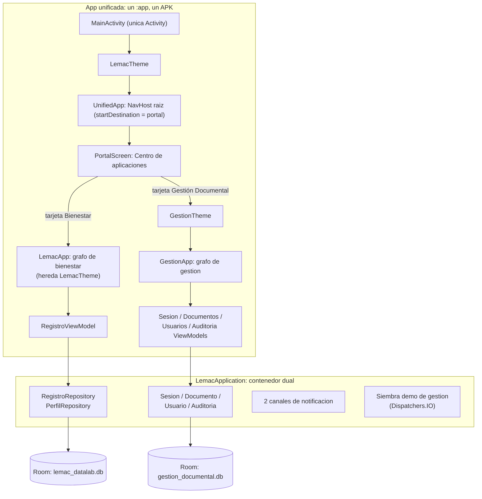

# Informe de integracion: Lemac DataLab + Gestión Documental RR.HH.

Este documento explica como y por que se fusionaron dos aplicaciones Android —el autorregistro de bienestar **Lemac DataLab** y el sistema **Gestión Documental RR.HH.**— en una sola app, en la rama `integracion` del proyecto `limpio_model`. Es la referencia de la decision tomada, del inventario de lo integrado, de la politica de respaldo, del estado de build y pruebas, y de la deuda tecnica conocida.

- Fecha del informe: 10 de noviembre de 2026.
- Rama: `integracion` (rama principal: `main`).
- Estado: integracion compilada y probada (build y pruebas verificados). **El commit final de la integracion esta pendiente** al momento de escribir este documento; ver la seccion de trazabilidad.

## 1. Objetivo e instruccion del supervisor

El curso exige entregar los dos trabajos de Android Studio como **un solo proyecto funcional**. El supervisor instruyo explicitamente unificar:

- **Lemac DataLab** (bienestar): autorregistro en cuatro ambitos, Room `lemac_datalab.db`, recordatorios y exportacion CSV. Paquete original `com.example.limpio_moviles`.
- **Gestion Documental RR.HH.**: login, siete roles, documentos con versiones, bandeja de aprobacion, auditoria, usuarios y reportes. Room `gestion_documental.db`. Paquete original `com.example.gestiondocumental`.

La instruccion del supervisor **reemplaza la decision previa** de mantener ambos dominios como proyectos separados (decision `d7c47dc1`, "Separar Carta de Animo (bienestar) del sistema documental de RRHH"). Esa decision quedo desechada: lo que antes se justificaba por separacion de dominios ahora se resuelve con un portal que mantiene los dominios aislados dentro de una misma app.

Requisitos funcionales aceptados para la unificacion: portal de acceso, dos bases Room separadas, recursos y navegacion unificados, un solo APK compilando y pruebas unitarias de ambos modulos en verde.

## 2. Decision: ADR de la unificacion

### ADR-001: Unificar ambas apps en una sola (Opcion A: portal con dos modulos)

**Contexto.** Dos proyectos Android independientes deben entregarse como uno solo. Android permite una sola clase `Application` y conviene una sola `Activity` por app. Los dos dominios tienen identidades distintas: bienestar es privado y sin cuentas; gestion documental es un flujo laboral con roles y auditoria. Se evaluo como integrarlos sin romper la logica de ninguno.

**Decision.** Un unico modulo Gradle `:app` con dos paquetes Java (`com.example.limpio_moviles` y `com.example.gestiondocumental`), una sola `LemacApplication` como contenedor dual de dependencias, un solo `MainActivity`, y una navegacion raiz nueva (`UnifiedApp.kt`) que arranca en un **portal** (`PortalScreen.kt`) desde el que se entra a cada modulo. Cada modulo conserva su grafo de navegacion interno, sus ViewModels, su tema y **su propia base Room** (`lemac_datalab.db` y `gestion_documental.db`), de modo que los datos nunca se mezclan.

**Consecuencias.**

- El usuario percibe una sola app con un centro de aplicaciones; cada modulo sigue siendo navegable y testeable por separado.
- La logica de ninguno de los dos modulos originales se reescribio: solo se re-apunto la obtencion del contenedor de dependencias en gestion documental.
- Quedan dos bases Room separadas (mas infraestructura duplicada) y el paquete de gestion convive con modelos documentales duplicados y sin uso en el paquete de bienestar (deuda tecnica, seccion 7).

### Decisiones lemoria asociadas

| ID | Titulo | Que resolvio |
|---|---|---|
| `06db8960` | Unificar Lemac DataLab y Gestión Documental en una sola app (Opcion A) | Decision raiz. Reemplaza a `d7c47dc1` (separar dominios). |
| `8fbda4aa` | LemacApplication como contenedor unico | No pueden existir dos `Application` en un mismo proceso; `LemacApplication` expone ademas de las dependencias de bienestar las de gestion (`gestionDatabase`, `sesionRepository`, `documentoRepository`, `usuarioRepository`, `auditoriaRepository`). `AppNavigation.kt` de gestion obtiene el contenedor via FQN. |
| `becb5a95` | Portal + UnifiedApp como navegacion raiz | `NavHost` raiz con `startDestination = portal`; cada modulo montado con su tema y su grafo interno. |
| `9dd66883` | Fusion de recursos Android con backup selectivo | `strings.xml`, `file_paths.xml` y reglas de backup unificadas; exclusion de la base y los documentos de gestion. |
| `fe3cf217` | Afinar reglas backup y eliminar redundancia de tema | `sharedpref` acotado a `perfil_lemac.xml`; exclusion tambien de `gestion_documental.db-journal`; sin doble envoltura de `LemacTheme`; eliminado el estilo XML muerto de gestion. |

## 3. Por que la Opcion A (portal) y no la B o la C

Opciones consideradas y motivo de descarte:

| Opcion | Descripcion | Por que se descarto |
|---|---|---|
| Proyectos separados | Mantener dos APK / dos repos | Descartado de raiz: el supervisor instruyo entregar **una sola** app funcional. |
| **Opcion A: portal con dos modulos (elegida)** | Un `:app`, dos paquetes, portal de entrada, dos bases Room | Cumple la instruccion, aisla dominios y datos, riesgo minimo para la logica existente. |
| Opcion B: login unico compartido | Un solo login sirve para bienestar y gestion | Mezcla dominios incompatibles: bienestar funciona con seudonimo y **sin cuentas**; gestion documental es un flujo laboral con roles y permisos. Un login unico obligaria a acoplar identidades y permisos de dominios distintos. |
| Opcion C: proyecto Gradle multi-modulo | `:app` mas librerias `:core`, `:bienestar`, `:gestion` | Complejidad de build y de configuracion innecesaria para un MVP academico; ademas no resuelve nada que el portal no resuelva, y duplica configuracion de manifest y dependencias. |
| Dos `Application` en multiproceso | Registrar `GestionApplication` en el manifest | Android solo permite un `android:name` de Application por proceso; el multiproceso es innecesario para el caso. |
| Fusionar paquetes en `com.example.limpio_moviles` | Un solo paquete para todo | Alto riesgo de choques de nombres (`model/Entidades`, `Rutas`, `HomeScreen`, `theme`) y de romper logica ya probada. |
| Fusionar los dos grafos de navegacion | Un solo `NavHost` gigante | Refactor grande y riesgoso; mezcla rutas de dominios distintos. |
| Actividades separadas por modulo | Una Activity por modulo | Rompe la idea de unica app y duplica declaraciones en el manifest. |
| Bottom navigation con tabs compartidos | Unica pantalla con tabs de ambos dominios | Confunde al usuario: bienestar y RR.HH. no tienen relacion entre si. |

La Opcion A fue la que preservo intacta la logica de ambos modulos (solo se cambio la forma en que gestion documental obtiene el contenedor de dependencias) y a la vez presento una entrada unica y clara para el usuario.

## 4. Inventario de lo integrado

Todo el codigo de gestion documental se copio **dentro del mismo modulo `:app`**, conservando su paquete original `com.example.gestiondocumental`. No se creo ningun modulo Gradle nuevo.

### 4.1 Capa de datos (gestion documental)

- `data/local/GestionDatabase.kt`: base Room `gestion_documental`, con `GestionDatabase.obtener(contexto)` singleton.
- `data/local/Entidades.kt`: entidades Room (usuario, dependencia, documento, version, solicitud, auditoria).
- `data/local/Daos.kt`: DAOs por entidad, con `Flow` para observables.
- `data/local/Mappers.kt`: conversion entidad <-> modelo de dominio.
- `data/local/Sembrador.kt`: datos demo (4 dependencias, 7 usuarios, 6 documentos con versiones, 1 solicitud, 1 registro de auditoria) sembrados solo si la tabla de usuarios esta vacia.
- `data/repository/Repositorios.kt`: `SesionRepository`, `DocumentoRepository`, `UsuarioRepository` y `AuditoriaRepository`.

### 4.2 Dominio (gestion documental)

- `model/Enums.kt`: `Rol` (7 roles: funcionario, jefatura, administrativo, RR.HH., administrador del sistema, TI/ciberseguridad, supervisora), `EstadoDocumento`, `EstadoSolicitud`, `TipoCambio`, `CategoriaDocumento`, `Accion`.
- `model/Entidades.kt`: modelos de dominio (usuario, documento, version, auditoria).
- `model/Permisos.kt`: matriz de permisos por rol (que puede ver y hacer cada rol).
- `model/FlujoModificacion.kt`: reglas del flujo de solicitud, revision, aprobacion y rechazo.
- `model/Validadores.kt` y `model/Reportes.kt`: validacion de entradas y calculo de reportes.

### 4.3 UI y ViewModels (gestion documental)

- Pantallas (`ui/screens/`): `SplashScreen`, `LoginScreen`, `HomeScreen`, `DocumentosScreen`, `DetalleDocumentoScreen`, `BandejaAprobacionScreen`, `AuditoriaScreen`, `UsuariosScreen`, `ReportesScreen`.
- ViewModels (`viewmodel/`): `SesionViewModel`, `DocumentosViewModel`, `UsuariosViewModel`, `AuditoriaViewModel` y `Fabrica` (factory comun).
- Componentes y tema (`ui/components/`, `ui/theme/`): `TarjetaSolicitud`, componentes compartidos y `GestionTheme`.
- Utilidades (`util/`): archivos adjuntos y MIME, fechas y `NotificacionHelper` (canal propio del modulo).

### 4.4 Navegacion y portal (nuevo)

- `com/example/limpio_moviles/navigation/UnifiedApp.kt` (**nuevo**): `NavHost` raiz con `startDestination = portal` y las rutas `portal`, `bienestar` y `gestion`.
- `com/example/limpio_moviles/ui/screens/PortalScreen.kt` (**nuevo**): pantalla "Centro de aplicaciones" con dos tarjetas (Bienestar — Lemac DataLab y Gestión Documental RR.HH.) y un aviso de datos ficticios; textos con `contentDescription` accesible.
- `com/example/gestiondocumental/navigation/AppNavigation.kt` (**modificado**): obtiene el contenedor con `contexto.applicationContext as com.example.limpio_moviles.LemacApplication` (FQN) en lugar de su propia `GestionApplication`, que dejo de existir.
- La ruta de bienestar monta `LemacApp()` sin envolverlo en tema (MainActivity ya aplica `LemacTheme` a toda la app); la ruta de gestion monta `GestionTheme { GestionApp() }`.

### 4.5 Application, Activity y contenedor

- `LemacApplication.kt` (**modificado**): contenedor dual. Expone lo existente de bienestar (`database`/`lemac_datalab.db`, `registroRepository`, `perfilRepository`) y lo nuevo de gestion (`gestionDatabase`/`gestion_documental.db`, `sesionRepository`, `documentoRepository`, `usuarioRepository`, `auditoriaRepository`). En `onCreate` crea los **dos canales de notificacion** (bienestar y gestion) y lanza `Sembrador.sembrarSiVacio(gestionDatabase)` en `CoroutineScope(SupervisorJob() + Dispatchers.IO)`.
- `MainActivity.kt` (**modificado**): unico punto de entrada; `setContent { LemacTheme { UnifiedApp() } }`.

### 4.6 Recursos y manifiesto

- `res/values/strings.xml`: `app_name` unificado a "Lemac DataLab + Gestión Documental"; se conservan las 4 strings del canal y recordatorio de bienestar.
- `res/xml/file_paths.xml`: un solo `FileProvider` (authority `${applicationId}.fileprovider`) con `cache-path fotos/` (bienestar) y `files-path documentos/` (gestion). Android prohibe dos FileProvider con la misma authority.
- `res/values/themes.xml`: solo queda el tema XML de bienestar; el estilo visual de gestion es Compose (`GestionTheme`), y el `Theme.GestionDocumental` sin referencias fue eliminado.
- `res/xml/backup_rules.xml` y `res/xml/data_extraction_rules.xml`: reglas de respaldo selectivo por modulo (detalle en la seccion 6).
- `AndroidManifest.xml`: sin cambios de estructura; ya declaraba `LemacApplication`, un unico `MainActivity`, `POST_NOTIFICATIONS`, `uses-feature android.hardware.camera required="false"` y ningun permiso `INTERNET`.

### 4.7 Pruebas

- Se copiaron las 43 pruebas unitarias de gestion documental a `app/src/test/java/com/example/gestiondocumental/` (6 archivos: validadores, permisos, carga de permisos, flujo de modificacion, reportes y tipos MIME).
- Se mantienen las 26 pruebas de bienestar, incluidas las nuevas del repositorio con DAO falsificado y las ampliadas del exportador CSV.

## 5. Arquitectura resultante

Un solo APK, un solo modulo `:app`, una sola Activity y una sola Application. Dos dominios aislados por paquete y por base de datos.



Lectura del diagrama:

1. `MainActivity` monta `LemacTheme` y `UnifiedApp`, el `NavHost` raiz que arranca en el portal.
2. El portal no mezcla nada: cada tarjeta navega al grafo interno de su modulo, con su tema (gestion añade `GestionTheme`; bienestar hereda el de la Activity).
3. Cada modulo habla con sus propios repositorios; ambos conjuntos cuelgan del mismo contenedor `LemacApplication`.
4. Cada dominio persiste en su propia base Room: bienestar en `lemac_datalab.db` (con alias en `SharedPreferences` `perfil_lemac.xml` y foto `perfil.png`), gestion en `gestion_documental.db` (con documentos adjuntos en `files/documentos/`).
5. `LemacApplication.onCreate` crea los dos canales de notificacion y siembra la base de gestion la primera vez.

## 6. Recursos y respaldo (backup)

### Politica de respaldo por elemento

El manifiesto mantiene `android:allowBackup="true"`, pero las reglas XML definen una allowlist con exclusiones explicitas:

| Elemento | Dominio | Se respalda | Razon |
|---|---|---|---|
| `lemac_datalab.db` (Room de bienestar) | `database` | Si (`include path="."`) | Decision de producto: los registros de bienestar sobreviven a una migracion de dispositivo. |
| `perfil_lemac.xml` (SharedPreferences) | `sharedpref` | Si (`include perfil_lemac.xml`) | Solo contiene el alias o seudonimo y la ruta de la foto; no hay nombre real. |
| `gestion_documental.db` y sus `-wal`, `-shm`, `-journal` | `database` | No (`exclude`) | Datos laborales simulados; no deben salir del dispositivo. |
| `files/documentos/` (adjuntos de gestion) | `file` | No (`exclude`) | Contenido documental simulado de RR.HH. |
| `files/perfil.png` (foto de perfil de bienestar) | `file` | No (`exclude`) | Imagen personal; evitar respaldar datos biometricos/fotos. |
| Cache | — | No | La plataforma la excluye siempre de forma automatica; al usar `<include>`, el respaldo queda limitado a lo incluido. |

Las mismas reglas se aplican en tres lugares: `backup_rules.xml` (full backup, API 30 o inferior) y los dos bloques de `data_extraction_rules.xml` (API 31 o superior: `<cloud-backup>` y `<device-transfer>` identicos). El `include` de `sharedpref` esta acotado a `perfil_lemac.xml` (definido por `PerfilRepository.NOMBRE_PREFERENCIAS`) para no respaldar preferencias tecnicas no deseadas.

### Riesgos de privacidad conocidos

- Ninguna base esta cifrada (ni `lemac_datalab.db` ni `gestion_documental.db`). Un respaldo de Android o un dispositivo rooteado puede leer el contenido.
- Se respalda la base de bienestar **sin consentimiento explicito** del usuario: es una decision de producto que conviene revisar (opt-in del usuario, cifrado con SQLCipher o exclusion del respaldo). Ver deuda tecnica.
- La exclusion de `gestion_documental.db` del respaldo **no** la cifra en el dispositivo: solo evita que salga en backups y transferencias.
- Credenciales demo en claro: los 7 usuarios de gestion comparten la clave `1234`, almacenada sin hash.
- La app no declara `INTERNET`, asi que nada sale del dispositivo por red; el riesgo se limita al dispositivo, sus respaldos y el CSV exportado (texto plano con alias y notas).
- Notificaciones con texto generico, sin contenido sensible, en ambos modulos.

## 7. Deuda tecnica y limitaciones conocidas

1. **Modelos documentales duplicados y sin uso en `com.example.limpio_moviles.model`.** El checkpoint previo a la integracion (`769e20d`) copio `Entidades.kt`, `Enums.kt`, `FlujoModificacion.kt`, `Permisos.kt`, `Reportes.kt` y `Validadores.kt` del dominio documental al paquete de bienestar. La integracion final conservo el paquete original `com.example.gestiondocumental`, por lo que esas copias en `limpio_moviles.model` quedaron **sin referencias**. Hay que eliminarlas o, si se quiere compartir dominio, extraerlas a un modulo comun. Mientras existan, confunden al leer el arbol de paquetes.

2. **Literales de interfaz sin externalizar.** Casi todos los textos de ambos modulos (incluido `PortalScreen.kt`) estan hardcodeados en Kotlin; `strings.xml` solo tiene `app_name` y las 4 strings del canal/recordatorio de bienestar. Falta externalizar a recursos para consistencia, accesibilidad y futura localizacion.

3. **Siembra en IO sin bloquear el login.** `Sembrador.sembrarSiVacio(gestionDatabase)` corre en `CoroutineScope(SupervisorJob() + Dispatchers.IO)` lanzado desde `onCreate`, sin await ni reintento. Si el usuario abre el login de gestion antes de que termine la siembra, el primer intento puede fallar con "usuario no encontrado" y hay que reintentar. No bloquea la app (ventaja), pero falta un indicador o un reintento automatico.

4. **Credenciales demo en claro y seed en release.** La clave `1234` se guarda sin hash en Room y la siembra corre tambien en builds de **release** (no esta condicionada a `BuildConfig.DEBUG`). Aceptable para un MVP academico con datos ficticios; inaceptable para produccion (hash de claves, siembra solo en debug).

5. **Respaldo de la base de bienestar como decision de producto pendiente.** Se respalda `lemac_datalab.db` sin cifrar y sin consentimiento explicito. Si la app fuera real, habria que decidir: opt-in del usuario, cifrado de la base (por ejemplo SQLCipher) o exclusion del respaldo. Hoy la decision favorece la continuidad de datos sobre el maximo resguardo.

6. **Otras limitaciones.** Dos bases Room duplican la infraestructura de persistencia; los ViewModels de gestion dependen del contenedor via FQN (acoplamiento aceptado para no refactorizar); no hay pruebas de UI, instrumentadas, de navegacion ni de Room real (solo unitarias de logica pura y del repositorio con DAO falsificado); el APK de debug ronda los 65 MB (build de debug sin minificar); y las pruebas del portal y de las pantallas de gestion no existen.

## 8. Build y pruebas

Comandos usados para verificar la integracion, desde la raiz del proyecto:

```bash
# Compilar el APK unico de debug (verificado con --offline)
./gradlew :app:assembleDebug --offline

# Ejecutar todas las pruebas unitarias
./gradlew :app:testDebugUnitTest

# Instalar en emulador o dispositivo conectado
./gradlew :app:installDebug
```

Resultados verificados tras la integracion:

- `:app:assembleDebug --offline`: **BUILD SUCCESSFUL**. APK unico en `app/build/outputs/apk/debug/app-debug.apk` (contiene portal + bienestar + gestion).
- `:app:testDebugUnitTest`: **69 aprobadas, 0 fallidas**.
  - Bienestar: 26 (validador 9, resumen 4, exportador CSV 8, repositorio con DAO falso 5).
  - Gestion documental: 43 (validadores 4, permisos 7, carga de permisos 9, flujo de modificacion 6, reportes 9, MIME 8).
- Reporte HTML: `app/build/reports/tests/testDebugUnitTest/index.html`.
- Sin pruebas instrumentadas ni de interfaz (`app/src/androidTest` no existe).

## 9. Trazabilidad

Registros de Lemoria (PostgreSQL es la fuente de verdad; este informe es su reflejo en el repo):

- **Proyecto:** `136316a2-36dd-43b5-aa80-05b9e97d3f22` (`limpio_moviles`).
- **PRD:** `23938e63-e549-40a4-85ba-574ba0b73684` — "Integrar Lemac DataLab (bienestar) y Gestión Documental RR.HH. en una sola aplicacion Android funcional, con Portal de acceso, dos bases Room, recursos y navegacion unificados, compilando y con pruebas".
- **Conversacion:** `95545bb2-83c3-455a-8469-2568ad2e7f09`.
- **Flujo SDD del PRD:** prd, tasks, implement, test y review completados.

Tareas del flujo (todas en el PRD anterior):

| ID | Titulo | Estado |
|---|---|---|
| `073d3669` | Preparar rama integracion y checkpoint git | completada |
| `575c1a4a` | Integrar capa de datos y dominio de Gestion Documental | completada |
| `c3e278c1` | Integrar UI, ViewModels y navegacion de Gestion Documental | completada |
| `70f9cc29` | Unificar Application, canales y siembra de datos | completada |
| `c828b7c4` | Unificar recursos y AndroidManifest | completada |
| `35487ecd` | Crear Portal de inicio y enrutar a los dos modulos | completada |
| `3cd795ae` | Compilar APK unico y corregir errores | completada |
| `16105a7f` | Copiar y ejecutar pruebas unitarias de ambos modulos | completada |
| `0c671e67` | Endurecer backup y limpiar tema redundante | completada |
| `df47d52f` | Documentar la fusion y actualizar README (este informe) | en curso |
| `51797d87` | Commit final con trazabilidad | pendiente |

Decisiones lemoria:

| ID | Titulo | Estado |
|---|---|---|
| `06db8960` | Unificar Lemac DataLab y Gestión Documental en una sola app (Opcion A) | vigente |
| `8fbda4aa` | Integracion Android Opcion A: LemacApplication como contenedor unico | vigente |
| `becb5a95` | Portal + UnifiedApp como navegacion raiz de la app unificada | vigente |
| `9dd66883` | Fusion de recursos Android con backup selectivo de gestion documental | vigente |
| `fe3cf217` | Afinar reglas backup y eliminar redundancia de tema en app unificada | vigente |
| `d7c47dc1` | Separar Carta de Animo (bienestar) del sistema documental de RRHH | reemplazada por `06db8960` |

Estado de Git al escribir este informe: rama `integracion`; ultimo commit `769e20d` ("chore: checkpoint pre-integracion de modelos documentales"); cambios de la integracion pendientes de commit (tarea `51797d87`). **Cuando se haga el commit final, actualizar esta seccion con su hash y registrar el commit en Lemoria.**

## 10. Proximos pasos

Ademas de atender la deuda tecnica de la seccion 7, quedan dos frentes definidos:

### a) Actualizar el modulo de bienestar segun las respuestas de la contraparte DSY1105

Las respuestas de la contraparte academica definen cambios funcionales en Lemac DataLab que todavia no estan implementados:

- Escala de intensidad unificada de **0 a 4** (en lugar de los rangos actuales por ambito).
- Estado de animo con dimensiones de **depresion / elevacion**.
- **Login y consentimiento** para el modulo de bienestar (hoy entra sin autenticacion, con alias).
- **Cierre de sesion por inactividad.**
- **Alertas criticas** derivadas del autorregistro.
- Pantalla o seccion **"Registro de hoy"**.
- **Graficos de evolucion** de 7 y 30 dias.
- Conexion a una **API mock** (reemplazo o evolucion de `FakeLemacApi`).

Estos cambios afectan modelos, validadores, pantallas y pruebas del modulo de bienestar; conviene planificarlos como un PRD propio antes de tocar codigo.

### b) Preparar el video del Hito 2

Requisitos del video de avance:

- **Duracion:** 90 segundos.
- **Formato:** mp4, 720p.
- **Peso maximo:** 50 MB.
- **Fondo:** monocolor.
- **Nombre del archivo:** `VideoequipoX.mp4` (reemplazar la X por el numero de equipo).

El video deberia recorrer el portal, el flujo de bienestar y el flujo de gestion documental con los usuarios demo, cuidando que no aparezcan datos reales.
