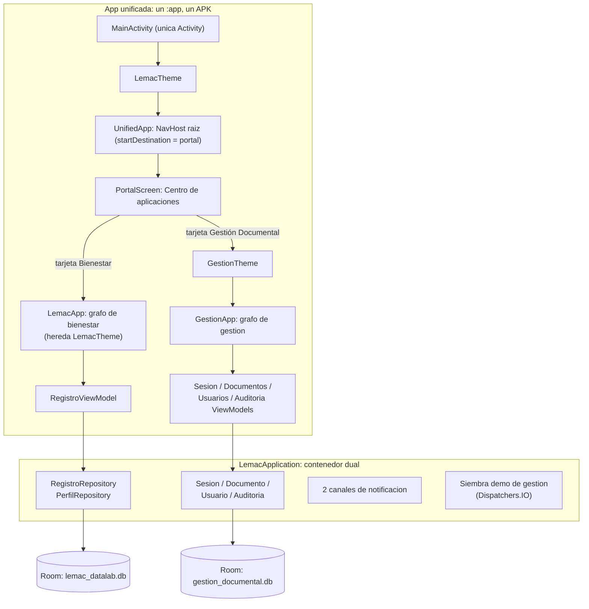

# Informe de integracion: Lemac DataLab + Gestión Documental RR.HH.

Este documento explica como y por que se fusionaron dos aplicaciones Android —el autorregistro de bienestar **Lemac DataLab** y el sistema **Gestión Documental RR.HH.**— en una sola app, en la rama `integracion` del proyecto `limpio_model`. Es la referencia de la decision tomada, del inventario de lo integrado, de la politica de respaldo, del estado de build y pruebas, y de la deuda tecnica conocida.

- Fecha del informe: 10 de noviembre de 2026; actualizado el 11 de noviembre de 2026 para registrar el commit final.
- Rama de la integracion: `integracion` (rama principal: `main`; el trabajo posterior sigue en `entrega_hito2`).
- Estado: integracion compilada, probada y **commiteada**. El commit final es `13ef480` ("feat: integracion de portal unificado (Gestion Documental RRHH + Lemac DataLab Bienestar)"), seguido del ajuste `690359f` ("fix: suprimir advertencia de permisos en NotificacionHelper"). Ver la seccion de trazabilidad.

## 1. Objetivo e instruccion del supervisor

El curso exige entregar los dos trabajos de Android Studio como **un solo proyecto funcional**. El supervisor instruyo explicitamente unificar:

- **Lemac DataLab** (bienestar): autorregistro en cuatro ambitos, Room `lemac_datalab.db`, recordatorios y exportacion CSV. Paquete original `com.example.limpio_moviles`.
- **Gestion Documental RR.HH.**: login, siete roles, documentos con versiones, bandeja de aprobacion, auditoria, usuarios y reportes. Room `gestion_documental.db`. Paquete original `com.example.gestiondocumental`.

La instruccion del supervisor **reemplaza la decision previa** de mantener ambos dominios como proyectos separados (decision `d7c47dc1`, "Separar Carta de Animo (bienestar) del sistema documental de RRHH"). Esa decision quedo desechada: lo que antes se justificaba por separacion de dominios ahora se resuelve con un portal que mantiene los dominios aislados dentro de una misma app.

Requisitos funcionales aceptados para la unificacion: portal de acceso, dos bases Room separadas, recursos y navegacion unificados, un solo APK compilando y pruebas unitarias de ambos modulos en verde.

## 2. Decision: ADR de la unificacion

### ADR-001: Unificar ambas apps en una sola (Opcion A: portal con dos modulos)

**Contexto.** Dos proyectos Android independientes deben entregarse como uno solo. Android permite una sola clase `Application` y conviene una sola `Activity` por app. Los dos dominios tienen identidades distintas: bienestar es privado y sin cuentas; gestion documental es un flujo laboral con roles y auditoria. Se evaluo como integrarlos sin romper la logica de ninguno.

**Decision.** Un unico modulo Gradle `:app` con dos paquetes Java (`com.example.limpio_moviles` y `com.example.gestiondocumental`), una sola `LemacApplication` como contenedor dual de dependencias, un solo `MainActivity`, y una navegacion raiz nueva (`UnifiedApp.kt`) que arranca en un **portal** (`PortalScreen.kt`) desde el que se entra a cada modulo. Cada modulo conserva su grafo de navegacion interno, sus ViewModels, su tema y **su propia base Room** (`lemac_datalab.db` y `gestion_documental.db`), de modo que los datos nunca se mezclan.

**Consecuencias.**

- El usuario percibe una sola app con un centro de aplicaciones; cada modulo sigue siendo navegable y testeable por separado.
- La logica de ninguno de los dos modulos originales se reescribio: solo se re-apunto la obtencion del contenedor de dependencias en gestion documental.
- Quedan dos bases Room separadas (mas infraestructura duplicada) y el paquete de gestion convive con modelos documentales duplicados y sin uso en el paquete de bienestar (deuda tecnica, seccion 7).

### Decisiones lemoria asociadas

| ID | Titulo | Que resolvio |
|---|---|---|
| `06db8960` | Unificar Lemac DataLab y Gestión Documental en una sola app (Opcion A) | Decision raiz. Reemplaza a `d7c47dc1` (separar dominios). |
| `8fbda4aa` | LemacApplication como contenedor unico | No pueden existir dos `Application` en un mismo proceso; `LemacApplication` expone ademas de las dependencias de bienestar las de gestion (`gestionDatabase`, `sesionRepository`, `documentoRepository`, `usuarioRepository`, `auditoriaRepository`). `AppNavigation.kt` de gestion obtiene el contenedor via FQN. |
| `becb5a95` | Portal + UnifiedApp como navegacion raiz | `NavHost` raiz con `startDestination = portal`; cada modulo montado con su tema y su grafo interno. |
| `9dd66883` | Fusion de recursos Android con backup selectivo | `strings.xml`, `file_paths.xml` y reglas de backup unificadas; exclusion de la base y los documentos de gestion. |
| `fe3cf217` | Afinar reglas backup y eliminar redundancia de tema | `sharedpref` acotado a `perfil_lemac.xml`; exclusion tambien de `gestion_documental.db-journal`; sin doble envoltura de `LemacTheme`; eliminado el estilo XML muerto de gestion. |

## 3. Por que la Opcion A (portal) y no la B o la C

Opciones consideradas y motivo de descarte:

| Opcion | Descripcion | Por que se descarto |
|---|---|---|
| Proyectos separados | Mantener dos APK / dos repos | Descartado de raiz: el supervisor instruyo entregar **una sola** app funcional. |
| **Opcion A: portal con dos modulos (elegida)** | Un `:app`, dos paquetes, portal de entrada, dos bases Room | Cumple la instruccion, aisla dominios y datos, riesgo minimo para la logica existente. |
| Opcion B: login unico compartido | Un solo login sirve para bienestar y gestion | Mezcla dominios incompatibles: bienestar funciona con seudonimo y **sin cuentas**; gestion documental es un flujo laboral con roles y permisos. Un login unico obligaria a acoplar identidades y permisos de dominios distintos. |
| Opcion C: proyecto Gradle multi-modulo | `:app` mas librerias `:core`, `:bienestar`, `:gestion` | Complejidad de build y de configuracion innecesaria para un MVP academico; ademas no resuelve nada que el portal no resuelva, y duplica configuracion de manifest y dependencias. |
| Dos `Application` en multiproceso | Registrar `GestionApplication` en el manifest | Android solo permite un `android:name` de Application por proceso; el multiproceso es innecesario para el caso. |
| Fusionar paquetes en `com.example.limpio_moviles` | Un solo paquete para todo | Alto riesgo de choques de nombres (`model/Entidades`, `Rutas`, `HomeScreen`, `theme`) y de romper logica ya probada. |
| Fusionar los dos grafos de navegacion | Un solo `NavHost` gigante | Refactor grande y riesgoso; mezcla rutas de dominios distintos. |
| Actividades separadas por modulo | Una Activity por modulo | Rompe la idea de unica app y duplica declaraciones en el manifest. |
| Bottom navigation con tabs compartidos | Unica pantalla con tabs de ambos dominios | Confunde al usuario: bienestar y RR.HH. no tienen relacion entre si. |

La Opcion A fue la que preservo intacta la logica de ambos modulos (solo se cambio la forma en que gestion documental obtiene el contenedor de dependencias) y a la vez presento una entrada unica y clara para el usuario.

## 4. Inventario de lo integrado

Todo el codigo de gestion documental se copio **dentro del mismo modulo `:app`**, conservando su paquete original `com.example.gestiondocumental`. No se creo ningun modulo Gradle nuevo.

### 4.1 Capa de datos (gestion documental)

- `data/local/GestionDatabase.kt`: base Room `gestion_documental`, con `GestionDatabase.obtener(contexto)` singleton.
- `data/local/Entidades.kt`: entidades Room (usuario, dependencia, documento, version, solicitud, auditoria).
- `data/local/Daos.kt`: DAOs por entidad, con `Flow` para observables.
- `data/local/Mappers.kt`: conversion entidad <-> modelo de dominio.
- `data/local/Sembrador.kt`: datos demo (4 dependencias, 7 usuarios, 6 documentos con 7 versiones, 1 solicitud, 1 auditoria SEED). Desde el hardening (19 de noviembre de 2026) la siembra es **transaccional** (`withTransaction`) y **convergente**: inserta solo las filas que faltan (dependencias/usuarios por id, documentos por titulo (clave natural), versiones por numero, solicitud por titulo+solicitante), usa los **ids reales** de los documentos para las versiones y repara siembras parciales sin duplicar. La auditoria `SEED` se inserta solo si no habia documentos antes de la pasada.
- `data/repository/Repositorios.kt`: `SesionRepository`, `DocumentoRepository`, `UsuarioRepository` y `AuditoriaRepository`.

### 4.2 Dominio (gestion documental)

- `model/Enums.kt`: `Rol` (7 roles: funcionario, jefatura, administrativo, RR.HH., administrador del sistema, TI/ciberseguridad, supervisora), `EstadoDocumento`, `EstadoSolicitud`, `TipoCambio`, `CategoriaDocumento`, `Accion`.
- `model/Entidades.kt`: modelos de dominio (usuario, documento, version, auditoria).
- `model/Permisos.kt`: matriz de permisos por rol (que puede ver y hacer cada rol).
- `model/FlujoModificacion.kt`: reglas del flujo de solicitud, revision, aprobacion y rechazo.
- `model/Validadores.kt` y `model/Reportes.kt`: validacion de entradas y calculo de reportes.

### 4.3 UI y ViewModels (gestion documental)

- Pantallas (`ui/screens/`): `SplashScreen`, `LoginScreen`, `HomeScreen`, `DocumentosScreen`, `DetalleDocumentoScreen`, `BandejaAprobacionScreen`, `AuditoriaScreen`, `UsuariosScreen`, `ReportesScreen`.
- ViewModels (`viewmodel/`): `SesionViewModel`, `DocumentosViewModel`, `UsuariosViewModel`, `AuditoriaViewModel` y `Fabrica` (factory comun).
- Componentes y tema (`ui/components/`, `ui/theme/`): `TarjetaSolicitud`, componentes compartidos y `GestionTheme`.
- Utilidades (`util/`): archivos adjuntos y MIME, fechas y `NotificacionHelper` (canal propio del modulo).

### 4.4 Navegacion y portal (nuevo)

- `com/example/limpio_moviles/navigation/UnifiedApp.kt` (**nuevo**): `NavHost` raiz con `startDestination = portal` y las rutas `portal`, `bienestar` y `gestion`.
- `com/example/limpio_moviles/ui/screens/PortalScreen.kt` (**nuevo**): pantalla "Centro de aplicaciones" con dos tarjetas (Bienestar — Lemac DataLab y Gestión Documental RR.HH.) y un aviso de datos ficticios; textos con `contentDescription` accesible.
- `com/example/gestiondocumental/navigation/AppNavigation.kt` (**modificado**): obtiene el contenedor con `contexto.applicationContext as com.example.limpio_moviles.LemacApplication` (FQN) en lugar de su propia `GestionApplication`, que dejo de existir.
- La ruta de bienestar monta `LemacApp()` sin envolverlo en tema (MainActivity ya aplica `LemacTheme` a toda la app); la ruta de gestion monta `GestionTheme { GestionApp() }`.

### 4.5 Application, Activity y contenedor

- `LemacApplication.kt` (**modificado**): contenedor dual. Expone lo existente de bienestar (`database`/`lemac_datalab.db`, `registroRepository`, `perfilRepository`) y lo nuevo de gestion (`gestionDatabase`/`gestion_documental.db`, `sesionRepository`, `documentoRepository`, `usuarioRepository`, `auditoriaRepository`, `documentosRemotosRepository`). En `onCreate` crea los **dos canales de notificacion** (bienestar y gestion) y lanza `Sembrador.sembrarSiVacio(gestionDatabase)` en `CoroutineScope(SupervisorJob() + Dispatchers.IO + manejadorErrores)`. Desde el hardening, `runCatching` + `CoroutineExceptionHandler` guardan el fallo en `@Volatile var ultimoErrorSiembra`, re-lanzan `CancellationException` y evitan que un error de siembra cierre la app.
- `MainActivity.kt` (**modificado**): unico punto de entrada; `setContent { LemacTheme { UnifiedApp() } }`.

### 4.6 Recursos y manifiesto

- `res/values/strings.xml`: `app_name` unificado a "Lemac DataLab + Gestión Documental"; se conservan las 4 strings del canal y recordatorio de bienestar.
- `res/xml/file_paths.xml`: un solo `FileProvider` (authority `${applicationId}.fileprovider`) con `cache-path fotos/` (bienestar) y `files-path documentos/` (gestion). Android prohibe dos FileProvider con la misma authority.
- `res/values/themes.xml`: solo queda el tema XML de bienestar; el estilo visual de gestion es Compose (`GestionTheme`), y el `Theme.GestionDocumental` sin referencias fue eliminado.
- `res/xml/backup_rules.xml` y `res/xml/data_extraction_rules.xml`: reglas de respaldo selectivo por modulo (detalle en la seccion 6).
- `AndroidManifest.xml`: sin cambios de estructura; ya declaraba `LemacApplication`, un unico `MainActivity`, `POST_NOTIFICATIONS`, `uses-feature android.hardware.camera required="false"` y ningun permiso `INTERNET` (antes de IT3; desde IT3 sí declara `INTERNET` para la API REST simulada de documentos, ver [INTEGRACION_API_IT3.md](INTEGRACION_API_IT3.md)).

### 4.7 Pruebas

- Se copiaron las 43 pruebas unitarias de gestion documental a `app/src/test/java/com/example/gestiondocumental/` (6 archivos: validadores, permisos, carga de permisos, flujo de modificacion, reportes y tipos MIME).
- Se mantienen las 26 pruebas de bienestar vigentes en la integracion (hoy son 33 tras anadir `RegistroViewModelTest`), incluidas las del repositorio con DAO falsificado y las ampliadas del exportador CSV.

## 5. Arquitectura resultante

Un solo APK, un solo modulo `:app`, una sola Activity y una sola Application. Dos dominios aislados por paquete y por base de datos.



Lectura del diagrama:

1. `MainActivity` monta `LemacTheme` y `UnifiedApp`, el `NavHost` raiz que arranca en el portal.
2. El portal no mezcla nada: cada tarjeta navega al grafo interno de su modulo, con su tema (gestion añade `GestionTheme`; bienestar hereda el de la Activity).
3. Cada modulo habla con sus propios repositorios; ambos conjuntos cuelgan del mismo contenedor `LemacApplication`.
4. Cada dominio persiste en su propia base Room: bienestar en `lemac_datalab.db` (con alias en `SharedPreferences` `perfil_lemac.xml` y foto `perfil.png`), gestion en `gestion_documental.db` (con documentos adjuntos en `files/documentos/`).
5. `LemacApplication.onCreate` crea los dos canales de notificacion y siembra la base de gestion de forma asincrona. Desde el hardening esa siembra es transaccional y convergente (repara estados parciales en cada arranque) y su fallo queda aislado en `ultimoErrorSiembra` sin cerrar la app.

## 6. Recursos y respaldo (backup)

### Politica de respaldo por elemento

El manifiesto mantiene `android:allowBackup="true"`, pero las reglas XML definen una allowlist con exclusiones explicitas:

| Elemento | Dominio | Se respalda | Razon |
|---|---|---|---|
| `lemac_datalab.db` (Room de bienestar) | `database` | Si (`include path="."`) | Decision de producto: los registros de bienestar sobreviven a una migracion de dispositivo. |
| `perfil_lemac.xml` (SharedPreferences) | `sharedpref` | Si (`include perfil_lemac.xml`) | Solo contiene el alias o seudonimo y la ruta de la foto; no hay nombre real. |
| `gestion_documental.db` y sus `-wal`, `-shm`, `-journal` | `database` | No (`exclude`) | Datos laborales simulados; no deben salir del dispositivo. |
| `files/documentos/` (adjuntos de gestion) | `file` | No (`exclude`) | Contenido documental simulado de RR.HH. |
| `files/perfil.png` (foto de perfil de bienestar) | `file` | No (`exclude`) | Imagen personal; evitar respaldar datos biometricos/fotos. |
| Cache | — | No | La plataforma la excluye siempre de forma automatica; al usar `<include>`, el respaldo queda limitado a lo incluido. |

Las mismas reglas se aplican en tres lugares: `backup_rules.xml` (full backup, API 30 o inferior) y los dos bloques de `data_extraction_rules.xml` (API 31 o superior: `<cloud-backup>` y `<device-transfer>` identicos). El `include` de `sharedpref` esta acotado a `perfil_lemac.xml` (nombre definido en `PerfilRepositorySharedPreferences`) para no respaldar preferencias tecnicas no deseadas.

### Riesgos de privacidad conocidos

- Ninguna base esta cifrada (ni `lemac_datalab.db` ni `gestion_documental.db`). Un respaldo de Android o un dispositivo rooteado puede leer el contenido.
- Se respalda la base de bienestar **sin consentimiento explicito** del usuario: es una decision de producto que conviene revisar (opt-in del usuario, cifrado con SQLCipher o exclusion del respaldo). Ver deuda tecnica.
- La exclusion de `gestion_documental.db` del respaldo **no** la cifra en el dispositivo: solo evita que salga en backups y transferencias.
- Credenciales demo en claro: los 7 usuarios de gestion comparten la clave `1234`, almacenada sin hash.
- La app no declaraba `INTERNET` (antes de IT3), asi que nada salia del dispositivo por red. Desde IT3 sí declara `INTERNET`, pero solo para la API REST **simulada y local** de documentos, con cleartext restringido a `10.0.2.2`, `localhost` y `127.0.0.1`; el riesgo sigue acotado al dispositivo, sus respaldos, el CSV exportado y ese servidor local.
- Notificaciones con texto generico, sin contenido sensible, en ambos modulos.

## 7. Deuda tecnica y limitaciones conocidas

1. **Modelos documentales duplicados y sin uso en `com.example.limpio_moviles.model`.** El checkpoint previo a la integracion (`769e20d`) copio `Entidades.kt`, `Enums.kt`, `FlujoModificacion.kt`, `Permisos.kt`, `Reportes.kt` y `Validadores.kt` del dominio documental al paquete de bienestar. La integracion final conservo el paquete original `com.example.gestiondocumental`, por lo que esas copias en `limpio_moviles.model` quedaron **sin referencias**. Hay que eliminarlas o, si se quiere compartir dominio, extraerlas a un modulo comun. Mientras existan, confunden al leer el arbol de paquetes.

2. **Literales de interfaz sin externalizar.** Casi todos los textos de ambos modulos (incluido `PortalScreen.kt`) estan hardcodeados en Kotlin; `strings.xml` solo tiene `app_name` y las 4 strings del canal/recordatorio de bienestar. Falta externalizar a recursos para consistencia, accesibilidad y futura localizacion.

3. **Siembra en IO sin bloquear el login (mitigada).** `Sembrador.sembrarSiVacio(gestionDatabase)` corre en `CoroutineScope(SupervisorJob() + Dispatchers.IO + manejadorErrores)` lanzado desde `onCreate`, sin await. Sigue sin indicador de progreso ni reintento automatico, asi que si el usuario abre el login antes de que termine, puede ver "No existe una cuenta con ese correo." y tener que reintentar. El hardening mitigó el impacto: la siembra es transaccional y convergente (no deja estados parciales), re-lanza cancelaciones y guarda el ultimo fallo en `ultimoErrorSiembra` sin cerrar la app; ademas, los fallos de acceso a datos en el login devuelven el mensaje "No se pudo acceder a los datos locales. Intenta nuevamente."

4. **Credenciales demo en claro y seed en release.** La clave `1234` se guarda sin hash en Room y la siembra corre tambien en builds de **release** (no esta condicionada a `BuildConfig.DEBUG`). Aceptable para un MVP academico con datos ficticios; inaceptable para produccion (hash de claves, siembra solo en debug).

5. **Respaldo de la base de bienestar como decision de producto pendiente.** Se respalda `lemac_datalab.db` sin cifrar y sin consentimiento explicito. Si la app fuera real, habria que decidir: opt-in del usuario, cifrado de la base (por ejemplo SQLCipher) o exclusion del respaldo. Hoy la decision favorece la continuidad de datos sobre el maximo resguardo.

6. **Otras limitaciones.** Dos bases Room duplican la infraestructura de persistencia; los ViewModels de gestion dependen del contenedor via FQN (acoplamiento aceptado para no refactorizar); casi no hay pruebas de UI ni de navegacion (solo 1 smoke Compose del portal), y faltan pruebas de Room del modulo de bienestar y de los ViewModels de gestion; el APK de debug ronda los 62 MB (build de debug sin minificar). **Novedad:** desde el hardening si hay 8 pruebas instrumentadas de Room real sobre `Sembrador` y 1 smoke del portal (9 en total), pero estan compiladas y **no ejecutadas** en este entorno por falta de `adb`/dispositivo.

## 8. Build y pruebas

Comandos usados para verificar la integracion, desde la raiz del proyecto:

```bash
# Compilar el APK unico de debug (verificado con --offline)
./gradlew :app:assembleDebug --offline

# Ejecutar todas las pruebas unitarias JVM (105)
./gradlew :app:testDebugUnitTest

# Compilar las pruebas instrumentadas (sin dispositivo)
./gradlew :app:assembleDebugAndroidTest

# Ejecutar las 9 pruebas instrumentadas (requiere adb + emulador/dispositivo)
./gradlew :app:connectedDebugAndroidTest

# Instalar en emulador o dispositivo conectado
./gradlew :app:installDebug
```

Resultados verificados tras la integracion (actualizados el 12 de noviembre de 2026; el detalle historico de la integracion fue 69 pruebas):

- `:app:assembleDebug`: **BUILD SUCCESSFUL**. APK unico en `app/build/outputs/apk/debug/app-debug.apk` (~62 MB; contiene portal + bienestar + gestion).
- `:app:testDebugUnitTest`: **76 aprobadas, 0 fallidas** (antes de IT3). Tras IT3 (15 de noviembre de 2026), el arbol tenia **95 pruebas** (33 de bienestar + 62 de gestion documental: 43 previas + 14 de red + 5 de `ApiConfigTest`); el informe de IT3 documento 90 por omission de este ultimo archivo en el inventario. Tras el cierre de hardening (19 de noviembre de 2026, commit `8832145`), **105 aprobadas, 0 fallidas** (33 de bienestar + 72 de gestion documental).
  - Bienestar: 33 (validador 9, resumen 4, exportador CSV 8, repositorio con DAO falso 5, ViewModel en JVM 7).
  - Gestion documental: 72 (regresion `BASE_URL` 5, sesion 10, validadores 4, permisos 7, carga de permisos 9, flujo de modificacion 6, reportes 9, MIME 8, contrato JSON IT3 6, repositorio remoto IT3 4, ViewModel remoto IT3 4).
- `:app:assembleDebugAndroidTest`: **BUILD SUCCESSFUL**. Hay **9 pruebas instrumentadas** en `app/src/androidTest`: 8 de siembra Room (`SembradorInstrumentedTest`) y 1 smoke Compose del portal (`PortalSmokeTest`). **No se ejecutaron** porque el entorno no tiene `adb` ni dispositivo/emulador; con uno disponible: `./gradlew :app:connectedDebugAndroidTest`.
- Configuracion de tests: `unitTests.isReturnDefaultValues = true` en `app/build.gradle.kts` (necesario para `kotlinx-coroutines-test` sin `Looper` de Android); `androidx.test:core` y `androidx.test:runner` alineados a `1.6.1` en `gradle/libs.versions.toml`.
- Reporte HTML: `app/build/reports/tests/testDebugUnitTest/index.html`.

## 9. Trazabilidad

Registros de Lemoria (PostgreSQL es la fuente de verdad; este informe es su reflejo en el repo):

- **Proyecto:** `136316a2-36dd-43b5-aa80-05b9e97d3f22` (`limpio_moviles`).
- **PRD:** `23938e63-e549-40a4-85ba-574ba0b73684` — "Integrar Lemac DataLab (bienestar) y Gestión Documental RR.HH. en una sola aplicacion Android funcional, con Portal de acceso, dos bases Room, recursos y navegacion unificados, compilando y con pruebas".
- **Conversacion:** `95545bb2-83c3-455a-8469-2568ad2e7f09`.
- **Flujo SDD del PRD:** prd, tasks, implement, test y review completados.

Tareas del flujo (todas en el PRD anterior):

| ID | Titulo | Estado |
|---|---|---|
| `073d3669` | Preparar rama integracion y checkpoint git | completada |
| `575c1a4a` | Integrar capa de datos y dominio de Gestion Documental | completada |
| `c3e278c1` | Integrar UI, ViewModels y navegacion de Gestion Documental | completada |
| `70f9cc29` | Unificar Application, canales y siembra de datos | completada |
| `c828b7c4` | Unificar recursos y AndroidManifest | completada |
| `35487ecd` | Crear Portal de inicio y enrutar a los dos modulos | completada |
| `3cd795ae` | Compilar APK unico y corregir errores | completada |
| `16105a7f` | Copiar y ejecutar pruebas unitarias de ambos modulos | completada |
| `0c671e67` | Endurecer backup y limpiar tema redundante | completada |
| `df47d52f` | Documentar la fusion y actualizar README (este informe) | completada |
| `51797d87` | Commit final con trazabilidad | completada (commit `13ef480`) |

Decisiones lemoria:

| ID | Titulo | Estado |
|---|---|---|
| `06db8960` | Unificar Lemac DataLab y Gestión Documental en una sola app (Opcion A) | vigente |
| `8fbda4aa` | Integracion Android Opcion A: LemacApplication como contenedor unico | vigente |
| `becb5a95` | Portal + UnifiedApp como navegacion raiz de la app unificada | vigente |
| `9dd66883` | Fusion de recursos Android con backup selectivo de gestion documental | vigente |
| `fe3cf217` | Afinar reglas backup y eliminar redundancia de tema en app unificada | vigente |
| `d7c47dc1` | Separar Carta de Animo (bienestar) del sistema documental de RRHH | reemplazada por `06db8960` |

Estado de Git tras la integracion (actualizado el 11 de noviembre de 2026): el commit final ya existe. En la rama `integracion`, el commit `13ef480` ("feat: integracion de portal unificado (Gestion Documental RRHH + Lemac DataLab Bienestar)") contiene toda la integracion sobre el checkpoint `769e20d` ("chore: checkpoint pre-integracion de modelos documentales"). Ese commit ya esta en `main` y en la rama de trabajo actual `entrega_hito2`, que agrega ademas el ajuste `690359f` ("fix: suprimir advertencia de permisos en NotificacionHelper", que agrega `@SuppressLint("MissingPermission")` al `NotificacionHelper` de gestion despues de verificar el permiso con `puedeNotificar`). El arbol de trabajo esta limpio.

## 10. Proximos pasos

Ademas de atender la deuda tecnica de la seccion 7, quedan dos frentes definidos:

### a) Actualizar el modulo de bienestar segun las respuestas de la contraparte DSY1105

Las respuestas de la contraparte academica definen cambios funcionales en Lemac DataLab que todavia no estan implementados:

- Escala de intensidad unificada de **0 a 4** (en lugar de los rangos actuales por ambito).
- Estado de animo con dimensiones de **depresion / elevacion**.
- **Login y consentimiento** para el modulo de bienestar (hoy entra sin autenticacion, con alias).
- **Cierre de sesion por inactividad.**
- **Alertas criticas** derivadas del autorregistro.
- Pantalla o seccion **"Registro de hoy"**.
- **Graficos de evolucion** de 7 y 30 dias.
- Conexion a una **API mock** (reemplazo o evolucion de `FakeLemacApi`).

Estos cambios afectan modelos, validadores, pantallas y pruebas del modulo de bienestar; conviene planificarlos como un PRD propio antes de tocar codigo.

### b) Preparar el video del Hito 2

Requisitos del video de avance:

- **Duracion:** 90 segundos.
- **Formato:** mp4, 720p.
- **Peso maximo:** 50 MB.
- **Fondo:** monocolor.
- **Nombre del archivo:** `VideoequipoX.mp4` (reemplazar la X por el numero de equipo).

El video deberia recorrer el portal, el flujo de bienestar y el flujo de gestion documental con los usuarios demo, cuidando que no aparezcan datos reales.

## 11. Actualización IT3: integración con API REST

La actividad **IT3** agrega una integración de red real (Retrofit + OkHttp + Gson) sobre la funcionalidad Documentos: la pantalla "Documentos en línea" consume `GET /documentos` de una API REST simulada local. Esto introduce dos cambios respecto a lo descrito en este informe: (a) el manifiesto **sí declara `INTERNET`** desde IT3 (con cleartext restringido a `10.0.2.2`, `localhost` y `127.0.0.1`), y (b) la suite sube de 76 a **95 pruebas en el arbol** (33 de bienestar + 62 de gestión documental); el informe original de IT3 cito 90 al omitir `ApiConfigTest` en el inventario. El detalle completo, el contrato del endpoint y el registro de comandos están en [INTEGRACION_API_IT3.md](INTEGRACION_API_IT3.md). Con el cierre de hardening (19 de noviembre de 2026) la suite JVM es de **105 pruebas** (33 + 72) y se añadieron 9 instrumentadas; ver la sección 12.

> Pendiente: regenerar `informe_arquitectura.html` y `INFORME_ARQUITECTURA.pdf` para reflejar IT3 y el hardening (no se regeneraron en estas entregas).

## 12. Actualización hardening (19 de noviembre de 2026)

Cierre documentado de los cuatro frentes del PRD `045a2de8-e11f-4286-930f-ed582728e411`:

| Frente | Resultado | Commit |
|---|---|---|
| a) `BASE_URL` corregida a `http://10.0.2.2:8000/` + test de regresión | `ApiConfigTest` (5 pruebas) blinda la URL, el endpoint y el rechazo de loopback. | `d648c7e` |
| a2) Integración IT3 (Retrofit/Gson/StateFlow) | Cadena Compose → ViewModel → Repository → Retrofit → API simulada, 14 pruebas de red. | `d648c7e` |
| b) Siembra Room transaccional y arranque tolerante a fallos | `Sembrador` con `withTransaction`, convergente por clave estable e ids reales; `LemacApplication` con `CoroutineExceptionHandler`, `runCatching` y `ultimoErrorSiembra`. | `8832145` |
| c) Login robusto con auditoría best-effort | `CancellationException` propagada (M1), `_actual` asignado tras auditar LOGIN y limpiado en `finally` (m10), mensaje de error de acceso a datos. | `8832145` |
| d) Tests unitarios e instrumentados | 105 JVM (0 fallos) + 9 instrumentadas compiladas (8 Room + 1 smoke), sin ejecutar por falta de `adb`. | `8832145` |

Hallazgos de revisión resueltos: **M1** (propagar cancelación en login/auditoría), **M2** (siembra convergente por clave estable con ids reales), **m10** (sesión consistente ante cancelación de auditoría) y el ajuste post-review (re-lanzar cancelación en el seed; AndroidX test alineado a 1.6.1). Review final: **APROBADO CON OBSERVACIONES** (observaciones resueltas).

Trazabilidad Lemoria: proyecto `136316a2-36dd-43b5-aa80-05b9e97d3f22`, PRD `045a2de8-e11f-4286-930f-ed582728e411`, conversación `9b337131-5f44-49d8-b4f1-8edad505507b`, task de documentación `f8dfcced-828f-4140-8a27-3e350e295a43`. ADRs: `37d7d92c` (M1), `e32848b6` (M2), `b0bf8edc` (m10), `ab094bb8` (`isReturnDefaultValues`), más `42d32a6e`, `4e2dd090`, `30e5e778` y `abaccc4f` de soporte. El commit `8832145` **no está pusheado** aún por falta de credenciales HTTPS. Detalle cronológico en [NOTAS_TECNICAS.md](NOTAS_TECNICAS.md) y comportamiento explicado en el README, sección [Hardening de gestion documental y arranque](../README.md#hardening-de-gestion-documental-y-arranque).
